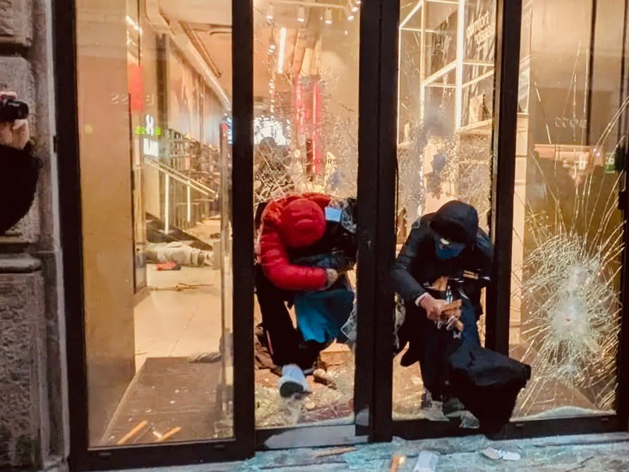

{fig-align="center"}

*Milano 17-18 ottobre e altri disordini.*

Partiamo da qui. Una cosa sono i manifestanti. Un'altra le frange violente. Un'altra ancora, gli eventuali infiltrati. Un altro piano di analisi riguarda gli immigrati di differenti generazioni, le culture di riferimento, le abitudini sociali. Sono distinzioni minime, ma decisive: se vogliamo comprendere cosa sia realmente accaduto a Milano, come in Francia e ovunque si sia innescata la guerriglia, ciascuno di tali aspetti andrebbe analizzato e compreso. E così riuscire a comprendere se le attuali manifestazioni vadano da qualche parte.

Eppure, spesso i dettagli che forniscono concretezza ai comportamenti politici non vengono nemmeno presi in considerazione: ogni questione viene ridotta a generalità oppure buttata direttamente in caciara. A molti, la realtà non sembra proprio interessare: tutto ciò che conta è confermarsi nel proprio pregiudizio. È una logica identitaria diffusa e aberrante a imporlo: ciascuno resta prigioniero di parzialità da cui sembra incapace di uscire.

Questa logica procede per antinomie che, pur escludendosi reciprocamente, condividono la stessa incapacità di afferrare il proprio stesso oggetto. Per chi si crede di sinistra, il pregiudizio dominante assume una forma antisistema tanto banale quanto impotente, e tuttavia alimenta la convinzione di appartenere a chissà quale movimento. Chi vuole essere di destra, ma alla moda, può invece ostentare il pregiudizio di un antiislamismo grottesco, privo di qualsiasi cognizione e nazionalista per ignoranza.

Ciò dimostra come nessuno schieramento ponga limiti alla strumentalizzazione degli eventi: non ci sono confini alle balle degli stessi esponenti politici, o chi ne fa le veci, che hanno contribuito a produrre danni. L'assedio in cui siamo coinvolti, comunque, non è uno scherzo. E peggiorerà ancora. Anche nella repressione del dissenso. La violenza è diffusa e lo stato, che pure ne è ancora l'azionista di maggioranza, non ne detiene più il monopolio. Ma ancora non sappiamo se tale violenza corrisponde ad un progetto oppure è pura psicosi.

Nel frattempo, per quanto si riesca a capire, maranza e altre bestie, alcune rigorosamente nostrane, infantili anche a prescindere dall'eventuale giovane età, contribuiscono ad accrescere il disordine e, al contempo, manifestano a favore del potere. Non capirebbero, né tantomeno gli interessa capire, che, in un contesto in cui la capacità di spesa generale è ormai fortemente ridotta, rubare una borsa firmata non incide affatto sulla distribuzione della ricchezza.

Una cosa, invece, è certa: gli individui sono sempre più tossicamente identificati con le pratiche di consumo. I grandi marchi ringraziano per l'apprezzamento e la pubblicità; il popolaccio resta tale ed esibisce la sua subordinazione pure quando crede di insorgere. La rivolta contro tutto finisce così per rivolgersi contro se stessa, celebrando il niente. E restiamo immobili, mentre il conflitto si consuma all’interno di un capitalismo senza scampo.
