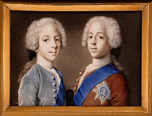

{fig-align="center" width="601"}

*Breve storia di una dinastia contestata, esiliata ed estinta, eppure persistente. Con particolari attenzioni alle disposizioni testamentali di Enrico Benedetto, detto il Cardinal Duca, vescovo di Frascati, e alla ipotetica e contestata discendenza di Carlo Edoardo, già noto come Little Pretender e Bonnie Prince Charlie.*

Che rimane della sovranità quando non può più governare? Cosa resta di una dinastia quando perde il trono? Può aiutare a rispondere a tali questioni la storia degli Stuart, che regnano in Scozia dal 1371 e dal 1603 anche in Inghilterra, per essere quindi costretti ad abbandonare le isole britanniche con la *Glorious Revolution* del 1688-9. Dopo aver transitatato per città della Francia e dello Stato della Chiesa, dal 1719 si stabiliscono a Roma.

Riscoprire i segni lasciati dagli Stuart nella storia europea e nell'Urbe può permette di osservare il passaggio tra *Ancient Régime* e modernità, e quindi le metamorfosi della sovranità. La considerazione di questi fattori può aiutarci a capire meglio le crepe del nostro presente e la crisi della legittimità delle forme di potere.

Il ritorno al trono di Giacomo II e VII è supportato dal movimento giacobita. Tra diplomazia e insurrezioni, la questione dinastica si inserisce nel quadro delle guerre civili e di religione. La possibile restaurazione degli Stuart, che appartengono alle grandi famiglie aristocratiche europee, trova il sostegno di Francia, Spagna, Stato della Chiesa e stati borbonici italiani.

La componente protestante della famiglia si estingue dopo Maria II e Anna, figlie di primo letto di Giacomo II e VIII; il trono britannico viene quindi attribuito agli Hannover. Giacomo Francesco Edoardo, conosciuto come l'*Old Pretender*, figlio di secondo letto del re esiliato, cattolico, insiste nella pretesa al trono. Sua consorte è Maria Clementina Sobieski, nipote di Giovanni III re di Polonia che contribuì alla difesa di Vienna durante l'assedio ottomano del 1683. Dalla loro unione nascono Carlo Edoardo ed Enrico Benedetto.

Carlo Edoardo, lo *Young Pretender*, effettua l'ultimo tentativo di riconquista nel 1745-6; la sua sconfitta a Culloden è accompagnata da forti repressioni in Scozia e da un definitivo riordino della politica europea. Enrico Benedetto, ordinato cardinale da Benedetto XIV Lambertini nel 1757, nel 1761 è nominato vescovo di Frascati. Il suo operato caratterizza fortemente le istituzioni ecclesiatiche ed è decisivo per la vita della cittadina e il territorio diocesiano. Il padre e il fratello del Cardinal Duca risiedono, oltre che a Palazzo Muti (Balestra) di fronte alla basilica di SS. Apostoli, anche ad Albano presso Palazzo Savelli (oggi sede comunale). Il rapporto degli Stuart con il contesto romano è quindi diretto e continuativo.

Rimangono sempre operanti le pretese sul trono britannico. Infatti, nel 1788, alla morte di Carlo Edoardo, Enrico Benedetto, coerentemente con il motto «*NON DESIDERIIS HOMINVM SED VOLVNTATE DEI*», impresso sulle medaglie commemorative, assume il titolo di Enrico I e IX. Estremizza, pur in assenza di regno, la concezione teocratica propria alla dinastia, che si oppone a quella espressa dall'ordine parlamentare. Non necessariamente questa è più "democratica" dell'altra, se custodia del regno significa tutelare la libertà del popolo, e il nome stesso della dinastia rimanda ad un ruolo di "re servitori".

Con gli ultimi esponenti, il potere perduto mantiene il senso della sovranità nella cerimonia e nella forma: essa è una disposizione che tende ad essere riconosciuta anche al di là dell'esercizio di governo. Nel 1807 muore il Cardinal Duca, e con lui si conclude la linea maschile degli Stuart. Nelle disposizioni testamentarie lascia indicazioni per la successione al trono. Seguendo la genealogia, il più accreditato sarebbe Carlo Emanuele IV di Savoia, a cui gli eventi legati alla Rivoluzione Francese avevano lasciato soltanto la Sardegna.

Carlo Emanuele IV muore senza discendenti diretti, e le speculazioni sulle genealogie giacobite si complicano ulteriormente. Peraltro, egli dimora a Frascati, dove si insediano anche Paolina e Luciano, sorella e fratello del Bonaparte. Ma le tensioni del territorio tuscolano e le complicazioni delle dinastie europee adesso non ci riguardano.

Puntuale interesse possono trovare invece le ipotesi e le speculazioni sulla discendenza di Carlo Edoardo, ufficialmente estintasi con la figlia naturale Charlotte, nata dalla sua amante Clementina Walkinshaw. La moglie Luisa Stolberg, amante di Vittorio Alfieri, con cui la rottura fu tale che anche i gioielli Sobieski consegnati in dote furono da lei restituiti, non gli diede figli.

Esistono tuttavia storie sulla prosecuzione della linea, alcune plausibili altre meno, non tutte documentate o documentabili. Tali storie sono significative soprattutto per comprendere il processo di reintegrazione memoriale presso la cultura britannica che segue alla morte di Enrico Benedetto, e l'influenza mantenuta dagli Stuart anche dopo la scomparsa dei loro esponenti ufficiali

Charlotte muore nel 1789. Secondo alcune ricostruzioni, da lei e da Ferdinand de Rohane, arcivescovo di Bordeaux, nascono tre figli, cresciuti in una condizione di semi-clandestinità tra i conventi di Francia e Germania; le due figlie, Marie Victoire Adelaide e Charlotte Maximilienne Amélie riescono a integrarsi nella società britannica, nel 1793 si trasferiscono in Polonia.

Sussiste quindi l’ipotesi che la prima abbia un figlio e la seconda una figlia e un figlio, sostenuta dalla storico Peter Piniński che si proclama loro discendente. Invece, Marie-Louise Backhurst ritiene che abbia figli Charles Edward, che assunse il nome di Conte Roehenstart, militare dalla vita avventurosa e poco credibile. Tali narrazioni sono molto discusse.

Rivendicazioni successive fanno riferimento a Luisa Stolberg, ufficialmente infeconda, forse per sterilità. Eppure, nel 1773 ella darebbe un figlio a Carlo: lo sostengono quelli che si proclamano suoi nipoti, i fratelli John Carter Allen e Charles Manning Allen, che assumono i nomi di John Sobieski Stolberg Stuart e Charles Edward Stuart. Perlopiù considerati impostori, identificano loro padre con il tenente di marina Thomas Allen, che sarebbe figlio illegittimo di Carlo Edoardo.

Un’altra ipotesi, ancora più oscura e inattendibile, riguarda un presunto matrimonio segreto avvenuto del novembre 1785 tra Carlo Edoardo e Margherita María Teresa O’Dea d’Audibert de Lussan. La sposa, discendente illegittima attraverso la linea dei d’Aubigny del prolifico Carlo II Stuart, padre di quattordici figli naturali riconosciuti, avrebbe dato alla luce nel 1786 un figlio maschio, Edoardo Giacomo Stuart, detto conte Stuarton.

La storiografia considera affermazioni di questo tipo come prive di fondamento probatorio. Possiamo considerarle quali tentativi di scongiurare l’estinzione anche simbolica della dinastia elaborandone una continuità occulta. Ad essere interessante è proprio l'intreccio tra storia e mito. E pure su ciò ci sarebbe di cui discutere. Lo faremo, insieme ad una storia di secoli, in un libro in arrivo: *stay tuned*.

Jean-Étienne Liotard, *Ritratto dei principi Carlo Edoardo ed Enrico Benedetto Stuart*, 1738 (circa 5,2 × 7,3 cm, acquerello e gouache su avorio, collezione privata, Ginevra)
