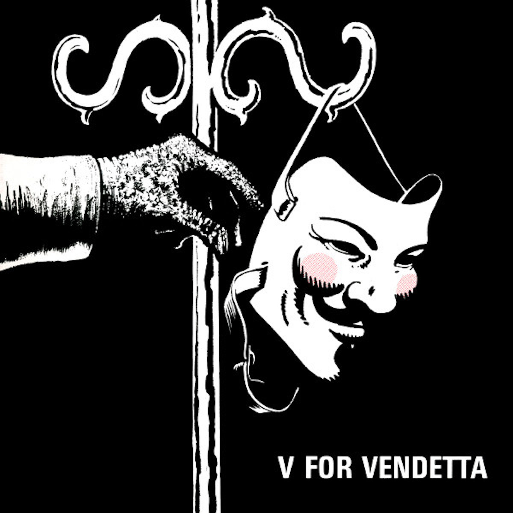

{fig-align="center"}

*Storia di una maschera*

## The gunpownder, treason and plot

La Congiura delle Polveri fu un complotto ai danni del Parlamento inglese e del re Giacomo I d'Inghilterra e VI di Scozia, il primo a riunire nella propria persona le corone delle isole britanniche. I conflitti di religione le dividono. Il Parlamento ha maggioranza anglicana, al suo interno acquistano sempre più peso le forze di orientamento puritano. Il re, battezzato con il rito cattolico ma educato secondo la confessione presbiteriana scozzese sotto la guida dell'umanista George Buchanan, è anche demonologo, autore del trattato *De Daemonologie* (1597); egli si attribuisce, oltre al compito di governare e legiferare, una missione di tutela dell'ordine religioso e morale, per ricondurvi unità. Ma l'idea della regalità di diritto divino propria agli Stuart è già sottoposta a forti tensioni.

L'unità religiosa è infranta, ogni Chiesa esclude l'altra, la società è in travaglio e si temono attacchi di altre potenze. Un gruppo di gentiluomini cattolici è convinto che, di fronte a una persecuzione nei loro confronti percepita come inarrestabile, resti soltanto la risorsa della violenza. Nella notte tra 4 e 5 novembre 1605 il complotto viene scoperto: sotto il Parlamento sono ritrovati trentasei barili di polvere da sparo. Gli otto congiurati sopravvissuti alla cattura vengono condannati per alto tradimento e giustiziati: tra loro Guy Fawkes, incaricato di sorvegliare gli esplosivi. Henry Garnet, superiore della missione gesuita in Inghilterra, che aveva avuto notizia del progetto cercando di dissuaderne i promotori, viene processato e giustiziato separatamente.

I cattolici d'Inghilterra sono sottoposti per lungo tempo a pesanti restrizioni; l'architettura domestica conserva i cosiddetti *Priest Holes*, passaggi e nascondigli destinati a proteggere i sacerdoti clandestini. Il fallimento della congiura viene festeggiato ogni anno nella *Bonfire Night*, istituzionalizzata nel 1606 con il *Thanksgiving Act*. In cima ai falò viene bruciato un pupazzo di paglia e vecchi vestiti, The Guy, che può rappresentare anche figure politiche contemporanee controverse. Ancora oggi, prima dell'apertura ufficiale del Parlamento da parte del sovrano, gli *Yeomen of the Guard* compiono una perquisizione cerimoniale nei sotterranei di Westminster con vecchie lanterne, per assicurarsi che non ci siano attentatori.

I conflitti tra Corona e Parlamento si acutizzano, portando alla *Civil War*, alla decapitazione di Carlo I e quindi al ventennio del *Commonwealth* e del *Protectorate* di Oliver Cromwell. I conflitti continuano. Secoli dopo, i parlamenti, disabitati dalla giustizia, rimangono in piedi. Guy Fawkes diventa una maschera, ideata da Alan Moore e disegnata da David Lloyd nel graphic-novel *V for Vendetta* (1982). La storia, ambientata in un Regno Unito distopico e totalitario, in un mondo freddo e cattivo quasi come il nostro, viene adattata ad un film diretto da Andy e Larry Wachowski (2005). La maschera di Guy Fawkes diventa una delle icone politiche contemporanee. Il segno di una ribellione sempre pronta ad esplodere. Testimone sghemba della lunga ombra lasciata dagli Stuart.

## Singin' Fawkes



Slow Walk - The 5th of November (Guy Fawkes)



Rebecca's Studio - The 5th of November (Guy Fawkes)



John Dowland - Fortune My Foe (instrumental)



Newberry Consort - Fortune My Foe (The Gunpowder Plot - Broadside Ballad)



Arthur Marshall - Guy Fawkes Song



Eire Apparent & Jimi Hendrix - Mr. Guy Fawkes



The Krewmen - Guy Fawkes



Wat Tyler - Song for Guy Fawkes



David J (ex Bauhaus) - This Vicious Cabaret (by V for Vendetta)

Illustrazione: David Lloyd, *V for Vendetta* - copertina realizzata per il disco di David J (1984)
