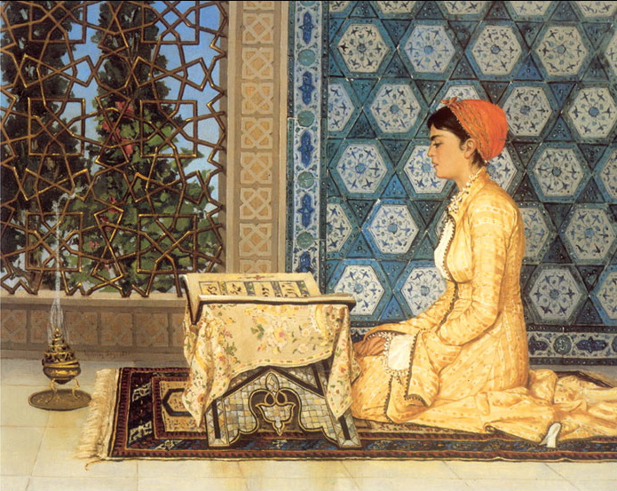

*Genealogia femminile e rivelazione nel Corano. Il velo tra tradizione mistica, femminismo islamico e interpretazione psicoanalitica. La maternità ontologica. Differenziazione e integrazione. Dalla logica dell'identità all'estetica delle relazione.*

## **1. Il nome e il velo**

Sono le donne a rappresentare l’autentico volto nascosto della cultura musulmana. In esse possiamo intravedere anche quanto l’Occidente nasconde a se stesso. La sottrazione è molteplice e stratificata. Sono nascoste le donne della tradizione genealogica islamica; i loro stessi nomi, con la sola eccezione di Maryam madre di Gesù, sono assenti dal testo coranico. Nel Corano, il velo stesso si accenna e si nasconde, cambiando nome e forme. Eppure, proprio il velarsi può essere letto come preludio alla rivelazione. Non si tratta soltanto il prendere le distanze dal dibattito mediatico che riduce il velo islamico a segno di sopraffazione, né tantomeno di assumerlo quale modello sociopolitico da idealizzare: interessante è piuttosto considerarlo come uno specchio critico, capace di far emergere il rimosso del nostro presente.

## **2. Le donne del Corano**

Agar è tradizionalmente considerata, attraverso Ismaele, una delle capostipiti degli arabi. La sua storia è narrata nella Tōrāh: è la serva egiziana di Abramo, madre di Ismaele, alla quale l’Angelo del Signore appare direttamente (Genesi 16:1-16; 21:9-21). Nel Corano, benché Ismaele sia esplicitamente ricordato, lei non viene nominata; la sua vicenda è tuttavia riconoscibile nell'allusione ad Abramo, che parla di aver stabilito parte della propria progenie in una «*valle senza coltivazione*» (Corano 14:37), in controcanto con il passaggio biblico che paragona Ismaele all’«*asino selvatico*» (Genesi 16:2). Nella *Ṣaḥīḥ al-Bukhārī* (IX d.C/ III AH), raccolta di tradizioni relative alle parole e agli atti del Profeta, viene raccontata la disperata corsa di Agar tra le colline di Safa e Marwa alla ricerca di acqua per il piccolo Ismaele; da tale vicendatrae origine il rito del *sa*ʿ*y* nel pellegrinaggioalla Mecca, durante il quale il percorso fra le due alture viene ripetuto sette volt**e.**

È una donna la prima persona ad entrare nell’Islam: Khadīja, detta anche Madre dei Credenti (*Umm al-Mu*ʾ*minīn*), titolo che spetta alle mogli del Profeta. È la prima moglie di Maometto, colei che lo rassicurò e lo sostenne dopo la prima rivelazione, riconoscendo nella sua esperienza l'autenticità della chiamata profetica. Anche Khadīja non trova menzione nel testo sacro dell’Islam, sebbene possa leggersi un riferimento alla sua presenza nell'accenno al sostegno economico ricevuto dal Profeta:«*Non ti ha trovato bisognoso e ti ha arricchito?*» (Corano 93:8). Nel *Ṣaḥīḥ al-Bukhārī*, dopo il primo incontro di Maometto con l’angelo Gabriele nella grotta di Hira, Khadīja pronuncia le parole che diverranno emblematiche della sua fiducia: «*Dio non ti umilierà mai*».

«*Dio intende solo tenere il male lontano da voi e purificarvi a fondo*» (Corano 33:33): il versetto della Purificazione, riferito alla Gente della Casa (*Ahl al-Bayt*), è stato interpretato quale riferimento a Fāṭima, suo marito ʿAlī e i loro figli al-Ḥasan e al-Ḥusayn. Fu invocato quando vennero raccolti sotto il mantello di Maometto (*ḥadīth al-kisā*ʾ), tradizione attestata anche nel *Ṣaḥīḥ Muslim* (865-870 d.C/250 AH). Un altro episodio in cui il Profeta riconosce in loro la propria famiglia, che trova a sua volta conferma nel *Ṣaḥīḥ Muslim*, è relativo alla *Mubāhala,* la disputa con i cristiani di Najrān contro cui sostengono che Gesù sia stato creato in maniera simile ad Adamo (Corano 3:61). Il *Ṣaḥīḥ al-Bukhārī* definisce Fāṭima «signora delle donne del Paradiso». Al-Tabarānī in Al-Mu'jam al-Kabīr (X d.C./ III-IV AH) si ricollega ad una testimoniata di al-Zubayrī estabilisce la prima ricorrenza del soprannome onorifico (kunyah) di Fāṭima quale Madre di suo Padre (Umm Abīhā). Per gli ḥadīth di tradizione sunnita raccolti in *Kanz al-*ʿ*Ummāl* (XVI d.C./X AH) e per le testimonianze tramandate da *al-Ṣawā*ʿ*iq al-Muḥriqa* (XVI d.C./X AH), che riguardano in particolare le virtù della famiglia del Profeta, il matrimonio di Fāṭima e ʿAlī corrisponde ad un decreto stabilito nei Cieli prima che sulla Terra. Nello sciismo duodecimano, l'unione di ʿAlī e Fāṭima costituisce il fondamento genealogico della successione dei dodici Imam: ʿAlī stesso inaugura la serie, e dalla loro discendenza, attraverso al-Ḥusayn, provengono quelli successivi, considerati guide spirituali designate da Dio.

La letteratura degli ḥadīth rivela quanto nel libro sacro dell’Islam è apparentemente nascosto. Il Corano stabilisce i principi universali e immutabili: la tradizione successiva ne conserva le vicende stabilizzandone significati e funzioni. Agar diventa l'archetipo della fiducia in Dio (*Al-Tawakkul*), della perseveranza nelle difficoltà (*Al-Ṣabr*) e della certezza della fede (*Al-Yaqīn*). Khadīja è modello del coraggio (*Al-Shajāʿah*), dell'intelletto (*Al-ʿAql*), della dedizione (*Al-Badhl*) e della generosità (*Al-Karam*). Fāṭima è la sorgente della legittimità divina della famiglia del Profeta (*Al-Wilāyah*), del distacco ascetico dalle illusioni e dai beni del mondo materiale (*Al-Zuhd*), della benedizione (*Al-Barakah*) e della purezza spirituale (*Al-ʿIṣmah*). L'*ʿiṣmah*, in particolare, assume una specifica valenza dottrinale nella teologia sciita, dove designa l'impeccabilità degli Imam e degli appartenenti alla famiglia del Profeta. L’associazione simbolica di Agar, Khadīja e Fāṭima alle virtù cardinali islamiche fa comprendere quanto tali figure siano state interiorizzate, e quindi quanto la loro manifestazione sia compiuta. Il silenzio del Corano corrisponde ad un’evidenza intima e spirituale.

## **3. Erotica della conoscenza**

Nella Sīra di Ibn Isḥāq, la più antica biografia di Maometto, trasmessaci nella redazione di Ibn Hishām (IX d.C./III AH), viene attribuito a Khadīja un particolare atto di discernimento. Dopo aver chiesto a Maometto di descriverle la presenza che lo visitava, ella lo invita a osservarla mentre lui la accoglie progressivamente accanto a sé e sul proprio grembo, per togliersi quindi il velo. Allo sparire della presenza, Khadīja conclude che fosse un angelo: infatti, secondo la logica del racconto, un demone sarebbe rimasto per compiacersi o per tentare, mentre un angelo di Dio, pura luce e assoluta santità, si ritira perché non può tollerare la violazione del pudore coniugale. In una variante del racconto, Khadīja accoglie Maometto sotto il proprio mantello e constata ugualmente la scomparsa della presenza. Il gesto dello svelamento trova quindi pieno significato conoscitivo: è la saggezza di una donna ad aver giocato un ruolo determinante nel tracciare il confine tra divino e demoniaco, e la natura della presenza invisibile viene rivelata attraverso la nudità femminile.

Donne e velo sono accostate riguardo alla conoscenza anche nel Corano. La donna che indossa il velo partecipa simbolicamente a una dimensione del nascondimento nella quale ciò che non appare immediatamente può custodire un significato ulteriore. In tale velarsi, vanno distinti *khimār* e il plurale *khumur* (copricapo) e *ḥijāb* (velo), che nel testo hanno significati e funzioni distinte.

Alle credenti viene prescritto di abbassare lo sguardo, custodire la propria castità, non esibire gli ornamenti e portare sul petto i propri *khumur* (Corano 24:31). Da parte sua, *ḥijāb* indica una separazione, una cortina, un impedimento alla visione, descrivendo in tal modo il velo interposto tra il Profeta e quanti non credono nell'aldilà (Corano 17:45); la riflessione successiva ha sovrapposto i significati di donna e *ḥijāb*, che il versetto non identifica direttamente, portando alla considerazione che è attraverso il proprio corpo velato che la donna può essere considerata quale possibile rappresentazione di tale separazione**.** Sul piano linguistico, è soprattutto l'uso storico successivo ad aver fatto di *ḥijāb* la denominazione corrente del velo femminile, collegando prescrizioni coraniche che impiegano termini differenti.

Il velo assume valenza erotica proprio dove rimarca l’irresistibilità di quanto nasconde; la nudità può rappresentare la verità nella propria manifestazione. Il velamento e il disvelamento costituiscono così i due momenti di una medesima dinamica: ciò che si sottrae suscita il desiderio di conoscere, mentre ciò che si manifesta non esaurisce necessariamente la verità che lo attraversa. In tale prospettiva, la castità non penalizza la sessualità né tantomeno la esclude: piuttosto, la eleva, riconoscendole una funzione nella realizzazione della persona e nella relazione con l'altro. 

Il velo trova quindi una funzione ambivalente, in modi concettualmente affini al Velo di Māyā elaborato nell’induismo e alle riflessioni sulla conoscenza e sull'illusione presenti nel Vedānta e nelle Upaniṣad. Nella visione sufi, al-Jīlī considera che esso può ostacolare la percezione dell'unità divina, ma anche rendere percepibile, attraverso quanto nasconde, la realtà che trascende il mondo visibile. Il velo pertanto non è soltanto ciò che impedisce di vedere: è anche ciò attraverso cui una conoscenza si rende possibile, secondo la misura e la capacità di chi contempla. (Titus Burckhardt, *De l’homme universel. Extraits du livre Al-Insan Al-Kamil*, 1953).

Parte del femminismo musulmano ha contestato la dicotomia occidentale che riduce il velo a mero simbolo di oppressione o di sottomissione, ricostruendo la formazione storica dei discorsi sulle donne e sul genere nelle società islamiche, mostrando come le pratiche di velamento abbiano assunto significati differenti secondo epoche e rapporti di potere (Leila Ahmed, *Women and Gender in Islam*, 1992). Il velo può così essere un potente segno di libertà, autonomia e resistenza politica, a patto che derivi da una libera scelta etica e spirituale e non da un'imposizione patriarcale o statale (Fatima Mernissi, *Beyond the Veil*, 1975-1987). La distinzione fra scelta e imposizione rimane decisiva, ma non esaurisce tutte le forme di soggettività religiosa. Infatti, il velo permette di definire un proprio rapporto con il divino come è proprio dell'Islam che, pur riconoscendo ruolo ad autorità, tradizioni e comunità, non prevede intermediazioni sacramentali simili a quelle cristiane, e il suo utilizzo può mettere l'accento su un’emancipazione che evita la mercificazione del corpo (Amina Wadud, *Inside the Gender Jihad: Women's Reform in Islam*, 2006). Desessualizzare il rapporto con il corpo femminile costringe inoltre la società a interagire con la donna sulla base della professionalità, dello status umano e dell'intelletto (al-ʿAql), in maniera comunque non riducibile all'idea liberale di autonomia o di resistenza alle norme (Saba Mahmood, Politics of Piety: The Islamic Revival and the Feminist Subject, 2005). Il velo costituisce quindi un atto politico di autodeterminazione che diventa simbolo di resistenza antirazzista e anticoloniale (Asma Barlas, *Believing Women in Islam: Unreading Patriarchal Interpretations of the Qur'an*, 2002). 

Per il femminismo musulmano il velo non ha un valore intrinseco o universale, ma dipende dalle condizioni storiche, sociali e soggettive in cui viene assunto**:** è il soggetto donna che, riappropriandosene attraverso la propria volontà, lo trasforma da potenziale indumento di clausura a dichiarato vessillo di libertà. Ciò non significa che ogni velamento sia una scelta libera, ma che nessuna interpretazione può esaurirne preventivamente il significato.

## **4. Il Libro e la Terra**

A fronte del riconoscimento “velato” di un femminile nascosto, sussiste esplicitamente nell’Islam il concetto di Madre del Libro, l’*Umm al-Kitāb*, figura della matrice celeste e del prototipo originario del Libro rivelato, custodito presso Dio, che precede la sua manifestazione nella parola umana (Corano 13:39; 43:4). La stessa denominazione, letteralmente materna, introduce una figura di generazione e custodia nella rivelazione.

L'espressione non indica un attributo divino in senso stretto. Nella tradizione esegetica è spesso riferita alla «*Tavola custodita*» (*al-Lawḥ al-Maḥfūẓ*), che si riferisce alla sua esistenza archetipica, alla sua incorruttibilità e inalterabilità, e al suo carattere di compimento della volontà divina (Corano 85:22). Tale espressione quindi frequentemente accostata a quella che con Madre del Libro allude ad libro-matrice concepibile quale immagine dell'origine, dalla quale il reale riceve il proprio ordine, conforme esclusivamente al volere divino: «*Allah cancella quello che vuole e conferma quello che vuole. È presso di Lui la Madre del Libro*» (Corano 13:39).

Nel tentativo di regolare il confine tra la Matrice eterna e la sua manifestazione storica, la natura del Corano trova diverse interpretazioni. Per la scuola Mutazilita è creato, e questa posizione viene assunta dagli sciiti. Per la scuola Hanbalita è increato, e tale concezione è prevalente presso i sunniti. Per la scuola Shafi'ita è increato il significato ma sono creati i supporti. Per la suola Hanafita sono increate le parole ma è creato l’atto di pronunciarle. In tutte queste varianti, la “maternità” che gli viene attribuita assume valenza metafisica: non semplice generazione biologica, ma matrice e custodia di ciò che precede ogni manifestazione. Tale apertura ontologica è specificata dal sufismo. Nella prospettiva di Ibn ʿArabī, l'essere umano e il mondo riconducono la propria esistenza alla loro provenienza divina e al ritorno a Dio. A tale concezione può essere accostata la formula «*noi siamo di Dio e a Lui ritorniamo*» (Corano 2:156).

Il Libro celebra la Terra. Essa non è l'antitesi dello Spirito, ma la sua sposa e il suo palcoscenico: accoglie la parola divina e la rende visibile, permette di leggere i segni disseminati nell’universo, dove “segni" è *āyāt*, termine che indica sia i versetti del Libro sia i fenomeni della natura. La Terra nella sua pienezza può così essere contemplata come luogo della manifestazione e della presenza divina e celebrata nella sua potenza generativa. (Alberto Ventura, *L’esoterismo islamic*o, 2017).

## **5. Castità e incesto**

Dall’argilla, elemento simbolico marcatamente femminile, è fatto l’uomo (Corano 15:26); la donna è ricondotta all'origine comune dell'umanità, nella figura della «singola anima» da cui Dio ha creato la sua compagna (Corano 4:1). Una concezione affine, pur entro un diverso orizzonte teologico, si ritrova nella Tōrāh (Genesi 2:21-23) e nella Cabala (*Zohar* II, 55a). La Cabala sviluppa inoltre, secondo una lettura mistica della creazione, l'immagine di un'originaria unità maschile e femminile, successivamente distinta. Come anche nel Cristianesimo, l'autentica umanità non si esaurisce in un genere isolato, ma si compie nella relazione tra uomo e donna.

Nell'orizzonte mistico islamico, l'idea di una salvezza integrale riconduce le tensioni e le differenziazioni all'Unità, mentre ogni cosa dispersa si completa riconducendosi all'Uno. È questa la prospettiva per cui la castità viene ricondotta al significato di integrità morale e personale, riportando al significato del termine latino *castus*. In sostanziale affinità con quanto elaborato dal teologo salesiano Xavier Thévenot (La chasteté: une saine régulation de la sexualité, 1982), viene suggerita una ricerca di differenziazione e quindi di crescita, riconoscimento dell'altro, complementarietà e unione.

Thévenot riprende l'opposizione etimologica fra *castus* e *incastus*, traducendo quest'ultimo con “incestuoso”, ampliando il significato del termine oltre il suo senso ordinario. L'incestuoso diventa così colui che cerca di prolungare o riprodurre lo stato originario di indifferenziazione fra bambino e figura materna. La castità, al contrario, è il processo attraverso cui l'individuo esce dalla condizione fusionale, riconosce l'alterità e costruisce la propria autonomia.

## **6. Paradiso e compimento**

Nella *Janna*, il Paradiso musulmano, il Corano descrive «*fanciulle, modeste di sguardo, bellissime d’occhi*» (Corano 37:48), figure tradizionalmente accostate alle *ḥūr*, termine che ricorre in maniera esplicita in altri passi coranici (44:54; 52:20, 55:72, 56:22). Tali figure trovano possibili analogie di forma, senza coincidenze teologiche, nello Zoroastrismo e nella figura femminile della Daēnā, che nel Hādōxt Nask si manifesta all'anima dopo la morte e la guida verso l'aldilà, secondo un'immagine escatologica il cui compimento paradisiaco è rappresentato dal Garōdmān, la Dimora del Canto.

Il significato di tali figure può essere interpretato come capacità di ricondurre le differenze ad una relazione capace di trasformarle in complementarietà. La Daēnā è lo specchio dell'anima, e si manifesta all'anima sul ponte Činvat come una fanciulla bellissima se l'anima è giusta, o come una megera orribile se l'anima è malvagia. La sua figura non è soltanto una guida esterna: rappresenta anche la forma visibile della condotta e delle scelte compiute durante la vita. Da parte loro, le ḥūr non rappresentano semplicemente un premio materiale, ma sono compimento di una purezza e di un’alterità che attende il credente nel Giardino. La complementarietà e l’unione non sono quindi date e non possono venir pretese, ma sono determinate da una scelta e da un percorso di reciproco riconoscimento. È tale capacità a trasformare la distanza e la potenziale opposizione in una dinamica costruttiva: paradiso e compimento non riguardano quindi l'isolamento dell’ego, ma significano piuttosto l'incontro con l’alterità.

Come in alcune correnti del Tantra, seppur con principi e articolazioni specifiche e diverse, forme maschili e femminili della divinità possono indicare un percorso di perfezionamento umano fondato su differenza e integrazione. Tale percorso si oppone tanto al rigorismo fondamentalista e al perpetuarsi delle false opposizioni che caratterizzano gli integralismi, quanto al livellamento delle diversità e alla mistificatoria confusione tra i generi e la proliferazione di identità su misura a cui possono condurre le forme più ottuse di progressismo.

Il fondamentalismo ragiona per opposizioni binarie, riducendo l’altro ad una minaccia da sottomettere o eliminare. Il progressismo tende a neutralizzare le specificità, creando un'indifferenziazione che impoverisce l'esperienza umana.  Ambedue le aberrazioni si basano su in una logica identitaria, tanto più convita di essere nel giusto quanto più sbaglia, incapace sia di riconoscere le diversità quanto di integrarle. 

## **7. La verità della non-conoscenza**

In ambito contemporaneo, Slavoj Žižek (*Islam and Modernity: Some Blasphemic Reflections*, 2015) riprende la lettura di Lacan della «*Femme-mascarade*» per interrogare la funzione del velo. La donna velata non nasconde semplicemente un corpo sottostante: il velo stesso produce l'illusione di una verità che si presume celata al di sotto. Il velo non nasconde semplicemente un oggetto del desiderio: produce e rende visibile il desiderio stesso, lasciando intravedere ciò che non può essere posseduto né interamente rappresentato.

Il fallo, in questa interpretazione, non coincide con il maschile anatomico, ma è il significante lacaniano della mancanza e del desiderio: non indica una presenza maschile reale nascosta nel femminile, ma una funzione simbolica che rende percepibile ciò che manca. Tale rivelazione è a sua volta velo. La stessa menzogna può così portare rivelazioni: la donna, capace nel desiderio che accende di rendere indistinguibile verità e illusione, può diventare figura di una conoscenza che non si lascia ridurre alla certezza. Žižek spinge questa ambiguità fino a riconoscere proprio nella donna, incarnazione dell'indecidibilità tra verità e menzogna, una possibile garante della verità. 

Il velo diventa quindi struttura del desiderio: non è una semplice privazione, ma diventa una condizione della manifestazione. Il femminile non è soltanto ciò che viene nascosto, ma è quanto rende possibile il rapporto con il nascosto.

La lettura del femminile proposta dalla psicoanalisi lacaniana non equivale a concepirlo quale possibile accesso al divino, come può invece essere suggerito da una lettura teologica islamica. In questa peraltro sussiste un limite intrascendibile della conoscenza umana di fronte all'inconoscibilità divina, rispetto alla quale larinuncia alla pretesa di sapere può diventare una forma superiore di conoscenza.

Abu Bakr, primo califfo e più intimo compagno del Profeta, è associato a una massima della tradizione mistica secondo cui Dio «*non ha dato alle proprie creature altra via per conoscerlo se non l'incapacità di conoscerlo*». Non si tratta tanto del vuoto quale principio ontologico dell'Essere che tutto trascende, quanto del riconoscimento del limite della conoscenza, di una non-conoscenza che diventa criterio di conoscenza. Riprende il paradosso Ibn ʿArabī (Futūḥāt al-Makkiyya, 1203 d.C/600 AH - 1238 d.C.-636 AH), che qualifica tale limite quale vertice supremo dell'illuminazione e della conoscenza del divino.

La purezza spirituale (ʿ*iṣmah*), il distacco ascetico (zuhd), la certezza assoluta (yaqīn), e le altre virtù che abbiamo trovato nelle figure femminili dell’Islam, trovano un'analogia nella tradizione cristiana nel libro di autore anonimo *The Cloud of Unknowing* (XIV secolo): la conoscenza razionale può applicarsi solo alle cose create, ma di fronte al Creatore essa deve arrendersi. Così come la «*nube della non conoscenza*» (*cloud of unknowing*) si interpone fra l'anima e Dio, la «*nube dell'oblio*» (*cloud of forgetting*) si colloca fra l'anima e tutto ciò che è creato**,** permettendo di seppellire, oltre ai peccati e alle distrazioni materiali, anche i pensieri teologici, le immagini sacre e i concetti colti. L’anima, così spogliata, può giungere a Dio attraverso l'amore. 

Quando Abu Razin chiese a Maometto dove si trovasse Dio prima di creare il mondo, egli rispose, alludendo allo stato di non-manifestazione: «*In una nube (ʿAmāʾ), sopra la quale non c'era aria e sotto la quale non c'era aria*». La tradizione è conservata nel *Jāmiʿ al-Tirmidhī,* ḥadīth 3109 (IX d.C./ III AH), dove il termine *“amā*” è suscettibile di differenti interpretazioni: nube, oscurità o condizione inconoscibile;il commento che accompagna la narrazione precisa che l'espressione può significare che nulla esisteva con Dio**.** In entrambe le sponde del misticismo medievale, l'Assoluto si rivela sottraendosi alle forme e ai nomi: la nube diventa così una figura della trascendenza che non può essere circoscritta dalla conoscenza**.** Nella nube della nostra contemporaneità, sottrarsi alle ingiunzioni e ai ruoli di un mondo impoverito può rappresentare quel piccolo assoluto che può permettere di preservare la propria libertà. 

L’idea di una verità intesa quale pieno e integrale “svelamento” viene così messa in crisi tanto dall’idea di un enigma femminile che copre il vuoto della mancanza simbolica con una menzogna indistinguibile dalla verità, quanto dall’idea di un’inconoscibilità che protegge l’uomo dall’eccedenza assoluta della Presenza divina. In tal modo, pur considerando la divaricazione di significati di cui è suscettibile, nemmeno il velo è soltanto se stesso. L'ossessione occidentale per la rimozione di ogni velo si rivela così quale la maschera dell’incapacità di riconoscere che qualcosa può non essere interamente posseduto o rappresentato. 

## **8. La manifestazione della mancanza**

Il velo non può banalmente offrire il pretesto per rivendicare alla modernità occidentale una sua presunta superiorità, ma nemmeno può rappresentare una soluzione sociale o politica da contrapporgli. Quanto è interessante è piuttosto considerarlo come lo schermo su cui l’attualità proietta le proprie stesse mancanze. 

Il femminismo ideologico si impunta su patriarcati immaginari per non ammettere il proprio petulante paternalismo, lontano ormai da ogni sovversione. I vertici del potere sono occupati da donne la cui arroganza replica ed esaspera gli stereotipi della burocrazia maschile. I modelli di bellezza più diffusi si stabilizzano su una femminilità ipersessualizzata e artificialmente costruita, ispirata a codici androgini standardizzati, sempre più svincolata dal riconoscimento della specificità del corpo femminile e della differenza sessuale.

Il femminile posticcio e quello artefatto pretendono quindi di imporsi quali modelli di parificazione dalla valenza universale: tuttavia, irrimediabilmente condizionati da tutto ciò a cui si oppongono, propagano convinzioni condannate ad esprimere parzialità, chiusura e disgregazione. Viene così a smarrirsi l’idea di complementarietà asimmetrica, quella che permette una relazione effettiva e reale, cioè che uomo e donna si rapportino non come due metà perfette, ma piuttosto come due modi differenti di fare i conti con una mancanza originaria. 

Lo smarrimento del rapporto propriamente intimo tra complementarietà ed enigma ha portato all'incapacità di riconoscere la differenza tra i sessi, trasformandola in separatismo aggressivo e in imitazione caricaturale reciproca, facendola decadere ad armatura difensiva o a prodotto di consumo identitario. La differenza sessuale smette di essere spazio di rivelazione e il rapporto tra sessi si ammala: lo testimonia anche l’onnipresente denuncia del narcisismo, spesso confusa nei riferimenti scientifici e clinici ma purtroppo piuttosto aderente alle concrete condizioni e di vita in cui il soggetto si ritrova nudo e spaventato di fronte all'alterità, esposto al collasso relazionare. 

La cura e la preservazione dei rapporti non riguarda comunque la logica dell’identità, che in tutte le sue varianti conduce a dominio, trasparenza assoluta e riduzione dell'Altro all'Uguale, ma piuttosto appartiene all'ambito dell’e*stetica della relazione*, che riguarda le molteplicità del suo farsi forma e rendersi riconoscibile, in gran parte ancora da scrivere ma di cui possiamo trovare gli assi nel legame concepito come opera d'arte vivente, nella custodia dell’enigma dell'Altro, nella tensione creativa delle differenze. Rappresenta quindi la transizione dall'ossessione per il “chi siamo” e per l'identità atomizzata e consumabile, alla cura del “come stiamo insieme” nelle nostre irriducibili differenze.

## **9. La perdita e l’enigma**

Non stiamo sostenendo che la cultura islamica abbia risolto le contraddizioni della modernità occidentale, né che la condizione concreta delle donne musulmane sia necessariamente espressione della profondità simbolica della cultura di riferimento. Quello che ci interessa è osservare due delle grandi nubi che gravano sul mondo contemporaneo, riguardanti rispettivamente il significato della funzione sacra e poetica del limite e il senso della trascendenza e dell’assoluto. E dove Žižek afferma che nei paesi islamici il vuoto rivoluzionario è stato capitalizzato e occupato dal fondamentalismo religioso, che ha intercettato la rabbia anticapitalista trasformandola in una lotta teologica, descrive una perversione reazionaria della modernità, non l’esperienza religiosa in quanto tale. 

Una vera alternativa può così essere rintracciata proprio nel comprendere quale tipo di conflitto trovi espressione nel pensiero religioso più avanzato, nel quale giungono ad espressione le strutture fondamentali dell’esistenza. La sua natura è ontologica ed epistemica, incentrata sul rifiuto del nichilismo sia nelle forme passive del consumo, sia in quelle attive del terrore. Queste infatti condividono lo stesso nucleo patologico: l'incapacità di abitare il vuoto, il limite e l’enigma, e il tentativo simmetrico di saturarlo, l'uno attraverso l'accumulazione infinita di oggetti posticci e la trasparenza burocratica, l'altro attraverso l'idolo totalitario di una legge letterale, fanatica e distruttiva.

Nel velo, figura propria alla tradizione islamica, possiamo leggere anche cosa possa significare il fenomeno diffuso della perdita dell'intimità e della relazione. Se la portata di ciò è tanto personale quanto globale e può certamente riguardare anche uomini e donne musulmane, i suoi presupposti teoretici sono occidentali e moderni, e corrispondono all’epistemologia predatoria per cui conoscere significhi necessariamente eliminare ogni enigma, e che riconoscere l'altro significhi renderlo uguale a sé. Ed è proprio questo a dimostrare come l’ignoranza e la sopraffazione riguardino proprio i dispositivi concettuali più tipici di un mondo solo apparentemente civilizzato.

Identificare la conoscenza con lo svelamento totale produce infatti l'illusione che l'essere umano sia interamente calcolabile, trasparente a se stesso e agli altri. È tale impostazione che porta a svuotare la relazione del suo elemento vitale: l'incontro con l'irriducibile alterità dell'altro. In tale prospettiva, l’altro non è più un soggetto da scoprire nel tempo dell'ascolto, ma si riduce ad un oggetto da consumare visivamente e cognitivamente.

Il velo è quindi anche il limite che separa l'interno dall'esterno e impedisce all’intimità di dissolversi in una costante esposizione pubblica. Tale limite non priva l'uomo di qualcosa, ma piuttosto istituisce lo spazio della reverenza e permette di custodire un'eccedenza. Accettare che l'altro mantenga la sua quota di inconoscibilità permette di preservare la relazione e di proteggere l'alterità dall'essere fagocitata dalla pretesa di sapere e possedere. La figura che ci viene in soccorso è propriamente quella dell’enigma, dal greco *aínigma*, a sua volta derivato dal verbo *ainíssomai*, che significa “parlare all'oscuro”, oppure “parlare copertamente”, o anche “parlare per allusioni”.

La dimensione in cui l'intimità dell'incontro umano e il senso dell'assoluto sono ancora suscettibili di essere dati è quella in cui viene ritrovata la capacità di accogliere quanto è diverso e quanto è ignoto e, così, di permettere al suo enigma di continuare a parlarci.

Come ciò possa accadere è, a sua volta, un enigma.

Stampa: Osman Hamdi Bey, *Kuran okuyan kiz* (1880)
