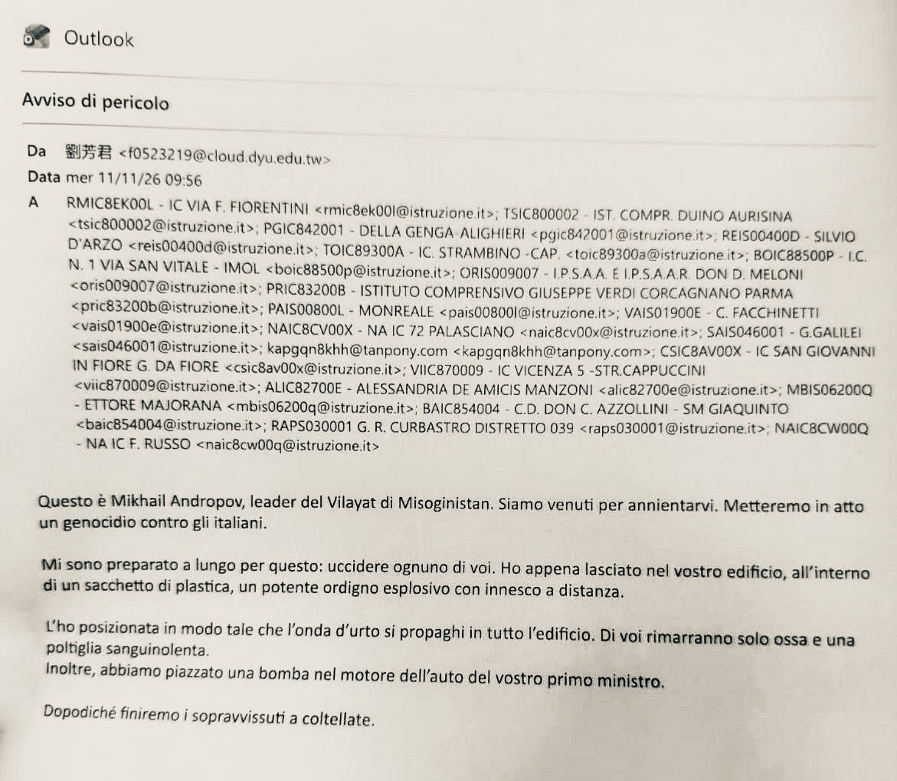

*Il terrorismo digitale tra drammi e facezie.*

Venir presi a coltellate tra una popolazione ridotta in poltiglia: così si concludeva la mail di minacce dell'11 novembre, ed è certamente una roba terribile. La segnalazione della presenza di ordigni nelle scuole si è però rivelata infondata. Le verifiche non hanno rinvenuto esplosivi e le autorità hanno dichiarato che non è emerso alcun pericolo concreto. Viene da immaginare che il messaggio sia stato scritto da un mitomane di sedici anni, che ha oggi mezzi più potenti di una cabina del telefono per sottrarsi al compito in classe.

L’infondatezza dell'allarme non rende irreali i suoi effetti concreti di panico, disorientamento e disagio, ma è necessario non confondere la minaccia con la sua rappresentazione. Nel demistificare lo stato di tensione in cui siamo costretti a vivere, potremmo scoprire che, per quanto possa sembrare strano, il Misoginistan ha un precedente reale, sebbene non come Stato effettivo.

Esso si collega infatti al Muzhskoye Gosudarstvo (Мужское государство), “Stato Maschile”, nato online nel 2016 sulla piattaforma VKontakte, un movimento ultranazionalista, razzista, omofobo, e ovviamente misogino, promosso dal blogger e personal trainer russo Vladislav Pozdnyakov. Il 18 ottobre 2021 il Tribunale regionale di Nižnij Novgorod lo ha dichiarato organizzazione estremista, vietandone le attività sul territorio russo. Non è quindi collegato allo stato russo e non risultano prove che venga diretto dagli apparati del Cremlino, per quanto sostenga la guerra di Putin in Ucraina.

Il divieto giudiziario non ne ha cancellato la circolazione attraverso i canali digitali, e il movimento è proseguito sotto la denominazione Male Legion, provvisto di account Telegram. Si tratta tuttavia di una rete fluida, non di un'organizzazione formalmente ricostituita con una struttura definita. Viene talvolta collocato, per quanto in modo ipotetico e problematico e privo di evidenze pubbliche, nella zona grigia che comprende l’hacktivismo di collettivi quali NoName057(16) e Z-Pentest Alliance. Questi ultimi il 4 novembre hanno rivendicato, attraverso un video diffuso via social, gli attacchi sviluppati via internet contro i sistemi di refrigerazione che hanno coinvolto anche l’Italia; Forescout documenta che dal gennaio 2026 ci sono state venti operazioni di questo tipo.

Per quanto riguarda gli allarmi relativi ai voli del 5 novembre, la mail che annunciava le esplosioni era firmata “Combattenti dello Stato Maschile”. Un account Telegram collegato alla galassia dello Stato Maschile ha negato alla BBC qualsiasi coinvolgimento. Anche tale elemento né dimostra né smentisce e deve venir accertato, e resta inoltre aperta la tesi investigativa che si tratti di un furto d'identità informatico (spoofing).

Una tecnica di falsificazione analoga potrebbe essere stata utilizzata anche per il messaggio dell'11 novembre, che risulta inviato da un indirizzo associato al dominio della Da-Yeh University di Taiwan. Secondo l'agenzia taiwanese CNA l’università ha individuato un account di posta elettronica appartenente a un ex studente, dal quale risultava un anomalo volume di invii. Lo ha quindi sospeso e ha avviato un'indagine. La provenienza apparente non dimostra né che l'autore si trovi a Taiwan, né un coinvolgimento dell'università, che da parte sua non ha ancora chiarito se si sia trattato di un'effettiva compromissione della casella di posta oppure di un uso abusivo dell'indirizzo, e l'identità dell'intestatario di questo non coincide necessariamente con quella dell'autore delle minacce.

Nelle minacce compare la denominazione “Vilayat di Misoginistan”. Vilayat (o wilāya) indica una provincia o una circoscrizione territoriale; essa è stata utilizzata anche nella denominazione delle province dell'organizzazione terroristica Stato islamico, pur non appartenendo in esclusiva al suo lessico ed essendo di possibile utilizzazione da parte di chiunque. Il termine, preso isolatamente, non costituisce dunque un indizio sufficiente per attribuire una matrice islamista al messaggio. Misoginistan poi, messa lì così, fa pure ridere.

Queste minacce sono firmate “Mikhail Andropov”, nome che evoca Jurij Andropov, che fu capo del KGB e segretario generale del Partito comunista dell'Unione Sovietica dal 1982 al 1984. Lo stesso pseudonimo era già apparso nelle minacce inviate il 6 novembre alle redazioni di alcune emittenti televisive europee, fra cui l'irlandese RTÉ e la bulgara Nova TV; la britannica Sky ha dichiarato di aver ricevuto minacce senza dichiararne l'autore. In Bulgaria nel mese di ottobre era circolata una rivendicazione analoga. Come ha osservato Reuters, il titolo della mail era "Message to the West", forse ricollegandosi simbolicamente a "New Challenge to the West", la biografia di Jurij Andropov. L’utilizzo del nome non dimostra comunque nessuna fliazione diretta. La sua ricorrenza nei diversi episodi, se suggerisce una continuità comunicativa, non dimostra che tutti gli episodi siano opera della stessa mano o che ci sia medesima ispirazione.

Per quanto non basti a dimostrare una precisa strategia, questa sovrapposizione di riferimenti sovietici, lessico di ascendenza islamica e cultura dei meme sembra costruita per produrre caos, suggerendo così una matrice tipica delle culture troll online, e comunque dimostra un intento di provocazione e destabilizzazione.

La situazione reale al momento è la seguente. Non c’è nessuna prova di responsabilità russa, né tantomeno islamista, né di una specifica operazione di guerra ibrida. Nessuno sta attuando un genocidio contro gli italiani. Nessuna bomba nel motore della presidente del consiglio. Per quanto possa forse pure dispiacere a qualcuno, il Misoginistan non esiste. Il pericolo concreto è stato giudicato piuttosto basso.

Eppure, il caos rimane. Per ridurne le cause, bisognerebbe uscire appena possibile dai conflitti in corso. Ma per fare la pace bisogna avere più forza che per fare la guerra, e oggi è proprio attraverso il caos che si governa e la debolezza domina ovunque. E basta poco per compromettere sistemi complessi. Quindi, dovremmo convivere a tempo indeterminato con tale situazione. Il problema è pertanto quello di riuscire a disinnescare il meccanismo attraverso cui una comunicazione anonima, tecnicamente elementare e di attendibilità bassissima, è in grado di produrre effetti collettivi enormi. La vulnerabilità è psicologica, informativa e organizzativa.

Tale vulnerabilità è piuttosto ingente: 6.300 sono le scuole raggiunte dalla comunicazione, mentre Associated Press riferisce, secondo il ministro Valditara, di almeno 300 scuole effettivamente evacuate. È pertanto opportuno farsi un’idea il più possibile onesta delle cose, utilizzando al meglio gli strumenti a disposizione, e conquistando quanto possibile uno stato di serenità.

Tutto questo non corrisponde forse al modo migliore per farsi followers, dato che in questa situazione di emergenza lo sciacallaggio emotivo si impone quale il miglior affare per qualsiasi sponda degli idioti che, lucrando sulla paura e sull’ignoranza, vogliono spartirsi il mondo. Eppure, sono convinto che si campi meglio senza alimentare tale circuito.

Poi fate come vi pare, ci mancherebbe, siamo in democrazia. Quantomeno, abbiamo libertà di giudizio, e sappiamo concederle tempi e modi adeguati. Giusto?

{alt="🏫"} Minacce alle scuole

Ricostruzione pratica dell'allarme e del testo: [https://www.ilpost.it/2026/11/11/scuole-mail-allarme-bomba/](https://l.facebook.com/l.php?u=https%3A%2F%2Fwww.ilpost.it%2F2026%2F11%2F11%2Fscuole-mail-allarme-bomba%2F%3Ffbclid%3DIwZXh0bgNhZW0CMTAAcGRvZgVzcnRjBmFwcF9pZBAyMjIwMzkxNzg4MjAwODkyAAEfZMM979TqMKVdN2bCi37fEuqrpXyjFm3paUvuO73gvoF5xIjdLNcRMFaFfvI_aem_0SIgrz8C7Iyl2_q9YG8VFw&h=AUDfwnGWTaEGKZfNhYuKF84Udxvs_pLt-HqNtlq2qiZK5QAeC6iJdXNqP5FENbW-ExDvwu5m-U1n8exFdkjhqpyt6tOz7AxB963TzPJU8B1ps3TuviLp-z9fEdqFA4sUNF4fzy_mEMKHsCX-wggWGg&__tn__=-UK-R&c%5B0%5D=AUD5kXbVn6siw3FIRmdv2rhbKL2urXMFRA11hr_--RGJQh0ELHwi7oJLxCZK7bRkqXmcqDZv1g-7JBTq0YQ7rao04szxthzpc7jqs6SUCs9wKCvvrqAZraaLRtH_ygP26vf-yuiYnyAbwgDKnDRDIbbzOBUaBR4BNA4rxXvGrvZiEBJZcXD2f_5IzqP9kvg)

Testo della mail, ipotesi su Russia, Iran e profilo Taiwan: [https://www.open.online/.../email-allarme-bomba-scuola.../](https://www.open.online/2026/11/11/email-allarme-bomba-scuola-testo-ipotesi-cosa-sappiamo/?fbclid=IwZXh0bgNhZW0CMTAAcGRvZgVzcnRjBmFwcF9pZBAyMjIwMzkxNzg4MjAwODkyAAEf06-C0WAjxuh8m7SSdNkbKGRk9wg2Ir-Q2PhW7PuBYe2X00dTr0Bf8VKdCD0_aem_vO6n1RxIXdxHgNto9N4uNg)

Cronaca delle evacuazioni e prime reazioni: [https://www.unisob.na.it/inchiostro/index.htm?idrt=10739](https://l.facebook.com/l.php?u=https%3A%2F%2Fwww.unisob.na.it%2Finchiostro%2Findex.htm%3Fidrt%3D10739%26fbclid%3DIwZXh0bgNhZW0CMTAAcGRvZgVzcnRjBmFwcF9pZBAyMjIwMzkxNzg4MjAwODkyAAEfXTnrLKi7dckz7ym9WflHuHjN20FKQzeLL5hHKYjMJlRm10WcJwM0X09sMgc_aem_6_ry1N2QPoFADjh2lV8Ncg&h=AUBTaAXs8P8m8irkRvvoqX6IPnE2DV-OFZYvbKgberaekO73tVUEi2Q95AxMTkn9vuceMnkNK6DbJskrcPMEhWuW8LhxhW42eSoyDjmx6ukdW_CWaMsw8rbEoMpwQ4XKw6hG6q1f_p1vDbuzbfR_dg&__tn__=-UK-R&c%5B0%5D=AUD5kXbVn6siw3FIRmdv2rhbKL2urXMFRA11hr_--RGJQh0ELHwi7oJLxCZK7bRkqXmcqDZv1g-7JBTq0YQ7rao04szxthzpc7jqs6SUCs9wKCvvrqAZraaLRtH_ygP26vf-yuiYnyAbwgDKnDRDIbbzOBUaBR4BNA4rxXvGrvZiEBJZcXD2f_5IzqP9kvg)

Analisi dello pseudonimo Mikhail Andropov e dei precedenti: [https://www.rainews.it/.../allarmi-bomba-nelle-scuole-chi...](https://www.rainews.it/articoli/2026/11/allarmi-bomba-nelle-scuole-chi-si-nasconde-dietro-lo-pseudonimo-mikhail-andropov-39e31a11-93d7-4008-adaa-ee62f4d8ecbe.html?fbclid=IwZXh0bgNhZW0CMTAAcGRvZgVzcnRjBmFwcF9pZBAyMjIwMzkxNzg4MjAwODkyAAEf06-C0WAjxuh8m7SSdNkbKGRk9wg2Ir-Q2PhW7PuBYe2X00dTr0Bf8VKdCD0_aem_vO6n1RxIXdxHgNto9N4uNg)

Bilancio del Ministro Valditara sugli istituti coinvolti: [https://it.investing.com/.../allarme-bomba-scuole-email...](https://it.investing.com/news/world-news/allarme-bomba-scuole-email-inviata-a-circa-6300-istituti--ministro-valditara-3643564?fbclid=IwZXh0bgNhZW0CMTAAcGRvZgVzcnRjBmFwcF9pZBAyMjIwMzkxNzg4MjAwODkyAAEf06-C0WAjxuh8m7SSdNkbKGRk9wg2Ir-Q2PhW7PuBYe2X00dTr0Bf8VKdCD0_aem_vO6n1RxIXdxHgNto9N4uNg)

Dispaccio di agenzia internazionale sugli allarmi in Italia: [https://www.afp.com/de/node/3852435](https://www.afp.com/de/node/3852435?fbclid=IwZXh0bgNhZW0CMTAAcGRvZgVzcnRjBmFwcF9pZBAyMjIwMzkxNzg4MjAwODkyAAEfB3UezedkBh9EPwaFgwrBdHkiUxTDVesUyrhVc7V5Ms2GtIpi6fQlf7neCM4_aem_GX3vXl6on5DfQTUnK6rM5g)

Dettagli sull'account compromesso usato per l'invio: [https://roma.repubblica.it/.../liu_fangjun_account.../amp/](https://roma.repubblica.it/cronaca/2026/11/11/news/liu_fangjun_account_email_allarmi_bomba_scuole-425715881/amp/?fbclid=IwZXh0bgNhZW0CMTAAcGRvZgVzcnRjBmFwcF9pZBAyMjIwMzkxNzg4MjAwODkyAAEfKPUO-bxte28AQ4QDggVHArvZH4Yloq3lF9l-8DNGig_egI7RorA9QtGcPVA_aem_KOXkG_C8lu4p6m4gdVsftw)

Copertura taiwanese sul coinvolgimento del dominio universitario: [https://www.cna.com.tw/news/aopl/202611110331.aspx](https://l.facebook.com/l.php?u=https%3A%2F%2Fwww.cna.com.tw%2Fnews%2Faopl%2F202611110331.aspx%3Ffbclid%3DIwZXh0bgNhZW0CMTAAcGRvZgVzcnRjBmFwcF9pZBAyMjIwMzkxNzg4MjAwODkyAAEfoE1Wil48NmuZ5c-12f_KSw48av2VvuJcAS2t-ts6Tc-2STMsybHKk3ghAdY_aem_aGGAqt7lrj1wsbD75jwYjg&h=AUBqJR32G3tZMnrG9zA0XfvlfqYDb593CGkNBifTwEZgQHXQDDyzviYz8npewQTg-ErdwUQRoJUOsuNAZElcsYdvWw_c5ZujXqG4_sFODaIIwJzmr_UygntFoDQeCa6XUukcAzT9WnHFsa5csckr3g&__tn__=-UK-R&c%5B0%5D=AUD5kXbVn6siw3FIRmdv2rhbKL2urXMFRA11hr_--RGJQh0ELHwi7oJLxCZK7bRkqXmcqDZv1g-7JBTq0YQ7rao04szxthzpc7jqs6SUCs9wKCvvrqAZraaLRtH_ygP26vf-yuiYnyAbwgDKnDRDIbbzOBUaBR4BNA4rxXvGrvZiEBJZcXD2f_5IzqP9kvg)

Dispaccio sulle evacuazioni di centinaia di scuole italiane: [https://www.reuters.com/.../least-300-italian-schools.../](https://l.facebook.com/l.php?u=https%3A%2F%2Fwww.reuters.com%2Fworld%2Fleast-300-italian-schools-evacuated-after-email-bomb-alerts-2026-11-11%2F%3Ffbclid%3DIwZXh0bgNhZW0CMTAAcGRvZgVzcnRjBmFwcF9pZBAyMjIwMzkxNzg4MjAwODkyAAEfZMM979TqMKVdN2bCi37fEuqrpXyjFm3paUvuO73gvoF5xIjdLNcRMFaFfvI_aem_0SIgrz8C7Iyl2_q9YG8VFw&h=AUCaFTi5HaCB-UIUSbXbQyzOT8Bz-P5ijGa9sMYWTi4kTaNrDOZlW7YVBRhm_FXnT5v-VEyN2ENdBHIScloxxUfV7VlnrB4EynnsYs0YrB6jza1tYeTkqWlxOchTtLTHrsg7Rg37FVZIikKRCfDmMg&__tn__=-UK-R&c%5B0%5D=AUD5kXbVn6siw3FIRmdv2rhbKL2urXMFRA11hr_--RGJQh0ELHwi7oJLxCZK7bRkqXmcqDZv1g-7JBTq0YQ7rao04szxthzpc7jqs6SUCs9wKCvvrqAZraaLRtH_ygP26vf-yuiYnyAbwgDKnDRDIbbzOBUaBR4BNA4rxXvGrvZiEBJZcXD2f_5IzqP9kvg)

Copertura internazionale e convocazione del vertice a Palazzo Chigi: [https://apnews.com/.../italy-bomb-threats-schools-meloni...](https://l.facebook.com/l.php?u=https%3A%2F%2Fapnews.com%2Farticle%2Fitaly-bomb-threats-schools-meloni-evacuation-0f312fda4ee2e9cdcebd0d6e1a40d9e8%3Ffbclid%3DIwZXh0bgNhZW0CMTAAcGRvZgVzcnRjBmFwcF9pZBAyMjIwMzkxNzg4MjAwODkyAAEfXTnrLKi7dckz7ym9WflHuHjN20FKQzeLL5hHKYjMJlRm10WcJwM0X09sMgc_aem_6_ry1N2QPoFADjh2lV8Ncg&h=AUBezmk7KT9e_e1zwFJE8qx5t1_-XgldBi0-2fFL3xsQPMRzD4fp04ahg79sM96Vz_cdASCYR5Vf14nMk95Ty1Suud_zFMm5l3_BkYvBOZ8_zNyQJ2K1KPDi5qc6Hgiwf7_ZdD7uOUxAJ5hVqOk7CA&__tn__=-UK-R&c%5B0%5D=AUD5kXbVn6siw3FIRmdv2rhbKL2urXMFRA11hr_--RGJQh0ELHwi7oJLxCZK7bRkqXmcqDZv1g-7JBTq0YQ7rao04szxthzpc7jqs6SUCs9wKCvvrqAZraaLRtH_ygP26vf-yuiYnyAbwgDKnDRDIbbzOBUaBR4BNA4rxXvGrvZiEBJZcXD2f_5IzqP9kvg)

{alt="✈️"} Minacce ai voli aerei

Cronaca degli allarmi sui cieli europei del 5 novembre: [https://lespresso.it/.../stato-maschile-bomba.../65757](https://l.facebook.com/l.php?u=https%3A%2F%2Flespresso.it%2Fc%2Fattualita%2F2026%2F11%2F5%2Fstato-maschile-bomba-allarme-mail-aeroporti-milano-malpensa-roma-fiumicino-europea-chi-sono-cosa-sappiamo%2F65757%3Ffbclid%3DIwZXh0bgNhZW0CMTAAcGRvZgVzcnRjBmFwcF9pZBAyMjIwMzkxNzg4MjAwODkyAAEfZMM979TqMKVdN2bCi37fEuqrpXyjFm3paUvuO73gvoF5xIjdLNcRMFaFfvI_aem_0SIgrz8C7Iyl2_q9YG8VFw&h=AUA9ST14F4_l3Z6_EKJ4tdu6NWD14uFTg5pyL5n2a-2r2NS4pz_nxL0ISuUoa4oF2PBrXzTf50aqXPVJpS3N6iKkF3dRMeTeTS4zX9XGwX-J7xATdCS9lPjyunymveYAAOo1sJSAwZZWTad2H_vLkQ&__tn__=-UK-R&c%5B0%5D=AUD5kXbVn6siw3FIRmdv2rhbKL2urXMFRA11hr_--RGJQh0ELHwi7oJLxCZK7bRkqXmcqDZv1g-7JBTq0YQ7rao04szxthzpc7jqs6SUCs9wKCvvrqAZraaLRtH_ygP26vf-yuiYnyAbwgDKnDRDIbbzOBUaBR4BNA4rxXvGrvZiEBJZcXD2f_5IzqP9kvg)

Il contenuto della mail firmata dai Combattenti dello Stato Maschile: [https://videoembed.ansa.it/.../allarmi-bomba-la-mail-di...](https://l.facebook.com/l.php?u=https%3A%2F%2Fvideoembed.ansa.it%2Fsito%2Fnotizie%2Fcronaca%2F2026%2F11%2F05%2Fallarmi-bomba-la-mail-di-segnalazione-firmata-dai-combattenti-dello-stato-maschile_eeaac407-6de2-4b26-bc38-15d1070dd3a5.html%3Ffbclid%3DIwZXh0bgNhZW0CMTAAcGRvZgVzcnRjBmFwcF9pZBAyMjIwMzkxNzg4MjAwODkyAAEfZMM979TqMKVdN2bCi37fEuqrpXyjFm3paUvuO73gvoF5xIjdLNcRMFaFfvI_aem_0SIgrz8C7Iyl2_q9YG8VFw&h=AUCddh5y8gJO6vO3aKnntTuXS1MHAhEQk_Scf9uq8eXP6tN7Jk6FK3uqcsrf5h2bRKXhS5-3jn1uFaaqktGozX_cvR33oiRetcJLj6UGB7rzg0_W0GlxLjjZHo4BB-Wt92OR9aDK7dm5hK0-oTuwvw&__tn__=-UK-R&c%5B0%5D=AUD5kXbVn6siw3FIRmdv2rhbKL2urXMFRA11hr_--RGJQh0ELHwi7oJLxCZK7bRkqXmcqDZv1g-7JBTq0YQ7rao04szxthzpc7jqs6SUCs9wKCvvrqAZraaLRtH_ygP26vf-yuiYnyAbwgDKnDRDIbbzOBUaBR4BNA4rxXvGrvZiEBJZcXD2f_5IzqP9kvg)

Estensione delle minacce bomba alle emittenti TV europee: [https://www.internazionale.it/.../bomb-threats-warning...](https://l.facebook.com/l.php?u=https%3A%2F%2Fwww.internazionale.it%2Fultime-notizie-reuters%2F2026%2F11%2F06%2Fbomb-threats-warning-the-clock-is-ticking-disrupt-tv-channels-across-europe%3Ffbclid%3DIwZXh0bgNhZW0CMTAAcGRvZgVzcnRjBmFwcF9pZBAyMjIwMzkxNzg4MjAwODkyAAEfB3UezedkBh9EPwaFgwrBdHkiUxTDVesUyrhVc7V5Ms2GtIpi6fQlf7neCM4_aem_GX3vXl6on5DfQTUnK6rM5g&h=AUC2-iRP3uyMITjYRr8AYQDNNCLNUmsVs1crxJXyuihEt5CpWt3m8G4SbsFzuMqTmsCtzGQmH_C0XrAGg7dHs4lxF0V1x7Jnq5q3kgeObCH7Y337QKebwAqjO2Ees8CHl6OVxKMGu9s0Knki7mOXkA&__tn__=-UK-R&c%5B0%5D=AUD5kXbVn6siw3FIRmdv2rhbKL2urXMFRA11hr_--RGJQh0ELHwi7oJLxCZK7bRkqXmcqDZv1g-7JBTq0YQ7rao04szxthzpc7jqs6SUCs9wKCvvrqAZraaLRtH_ygP26vf-yuiYnyAbwgDKnDRDIbbzOBUaBR4BNA4rxXvGrvZiEBJZcXD2f_5IzqP9kvg)

{alt="❄️"} Attentati ai frigoriferi

La rivendicazione degli hacker filorussi NoName057 e Z-Pentest: [https://www.corriere.it/.../hacker-filorussi-noname057-16...](https://l.facebook.com/l.php?u=https%3A%2F%2Fwww.corriere.it%2Ftecnologia%2F26_novembre_04%2Fhacker-filorussi-noname057-16-e-z-pentest-rivendicano-gli-attacchi-ai-supermercati-4653f95c-cbcf-4caa-b474-22e8c87dbxlk.shtml%3Ffbclid%3DIwZXh0bgNhZW0CMTAAcGRvZgVzcnRjBmFwcF9pZBAyMjIwMzkxNzg4MjAwODkyAAEfLfNLn4_QPoDoft56ZBPsmoFiP2u1vmcDhYK4_GgLf8my2WwksN_H3pBzFIs_aem_iV47qiALhhUGfqBUOcAYfg&h=AUATqTF_HpgCGLoj7sm2B0lRmBmyVxO7f6RWk-xhRmrpA717aK9VIPjRf6akltFCR-hgZEPlEMWszjVksDnInUeqTYYvORpQsKgRMfLqpCTcnNmwUv_FvxKfiuQB75hqiUZM08HQWA4wPWbTHVrmOw&__tn__=-UK-R&c%5B0%5D=AUD5kXbVn6siw3FIRmdv2rhbKL2urXMFRA11hr_--RGJQh0ELHwi7oJLxCZK7bRkqXmcqDZv1g-7JBTq0YQ7rao04szxthzpc7jqs6SUCs9wKCvvrqAZraaLRtH_ygP26vf-yuiYnyAbwgDKnDRDIbbzOBUaBR4BNA4rxXvGrvZiEBJZcXD2f_5IzqP9kvg)

Notizia sui sabotaggi informatici agli impianti dei supermercati: [https://www.ansa.it/.../tg1-due-gruppi-di-hacker...](https://l.facebook.com/l.php?u=https%3A%2F%2Fwww.ansa.it%2Fsito%2Fnotizie%2Fcronaca%2F2026%2F11%2F04%2Ftg1-due-gruppi-di-hacker-filorussi-rivendicano-attacchi-ai-supermercati_0cc61f52-06bc-4f69-8ba2-fb6d70f5dc79.html%3Ffbclid%3DIwZXh0bgNhZW0CMTAAcGRvZgVzcnRjBmFwcF9pZBAyMjIwMzkxNzg4MjAwODkyAAEfLfNLn4_QPoDoft56ZBPsmoFiP2u1vmcDhYK4_GgLf8my2WwksN_H3pBzFIs_aem_iV47qiALhhUGfqBUOcAYfg&h=AUBFJzOUHs1F5w1Kz2BVyrNL1E_NR3J3CCMwXcxDCFo4ePjgixIf04VfQXQU6dMuublmZsGiClxS8-v-JP7Nlc6MIGBPs_3AcSGTWCRSPFLcb_hc_AsLwTuFWnG0H_ULPCMLyxpZzRhvC-VaSJmuOg&__tn__=-UK-R&c%5B0%5D=AUD5kXbVn6siw3FIRmdv2rhbKL2urXMFRA11hr_--RGJQh0ELHwi7oJLxCZK7bRkqXmcqDZv1g-7JBTq0YQ7rao04szxthzpc7jqs6SUCs9wKCvvrqAZraaLRtH_ygP26vf-yuiYnyAbwgDKnDRDIbbzOBUaBR4BNA4rxXvGrvZiEBJZcXD2f_5IzqP9kvg)

Analisi tecnica sui rischi globali dei sistemi di refrigerazione esposti: [https://www.forescout.com/.../cold-chain-open-control...](https://l.facebook.com/l.php?u=https%3A%2F%2Fwww.forescout.com%2Fblog%2Fcold-chain-open-control-exposed-refrigeration-systems-reveal-global-risk%3Ffbclid%3DIwZXh0bgNhZW0CMTAAcGRvZgVzcnRjBmFwcF9pZBAyMjIwMzkxNzg4MjAwODkyAAEfB3UezedkBh9EPwaFgwrBdHkiUxTDVesUyrhVc7V5Ms2GtIpi6fQlf7neCM4_aem_GX3vXl6on5DfQTUnK6rM5g&h=AUD_eV3DmLHMJe4molSkwBus8aF9Riy1R7wX4f3aV-hGHANtxMICx_hGEPUQYpZ_PEcx0Q6bTsxgx2vFjeiBOV-rK8eGM5a5uHvI--YHfVCaBKIW3nIV_JZrPbgWdGFy0D8UTPA8B_DRgD9BrfQwOA&__tn__=-UK-R&c%5B0%5D=AUD5kXbVn6siw3FIRmdv2rhbKL2urXMFRA11hr_--RGJQh0ELHwi7oJLxCZK7bRkqXmcqDZv1g-7JBTq0YQ7rao04szxthzpc7jqs6SUCs9wKCvvrqAZraaLRtH_ygP26vf-yuiYnyAbwgDKnDRDIbbzOBUaBR4BNA4rxXvGrvZiEBJZcXD2f_5IzqP9kvg)

{alt="🇷🇺"} Storia dello Stato Maschile (Muzhskoye Gosudarstvo)

Profilo del gruppo, fondatore Vladislav Pozdnyakov e smentita dei legami con gli aerei: [https://tg24.sky.it/.../combattenti-stato-maschile-chi...](https://tg24.sky.it/mondo/2026/11/06/combattenti-stato-maschile-chi-sono-allarme-bomba-voli?fbclid=IwZXh0bgNhZW0CMTAAcGRvZgVzcnRjBmFwcF9pZBAyMjIwMzkxNzg4MjAwODkyAAEfXTnrLKi7dckz7ym9WflHuHjN20FKQzeLL5hHKYjMJlRm10WcJwM0X09sMgc_aem_6_ry1N2QPoFADjh2lV8Ncg)

Dalla persecuzione online di donne e minoranze alla propaganda filo-Putin: [https://ilmanifesto.it/stato-maschile-dalla-persecuzione...](https://ilmanifesto.it/stato-maschile-dalla-persecuzione-online-di-donne-e-minoranze-alla-propaganda-filo-putin?fbclid=IwZXh0bgNhZW0CMTAAcGRvZgVzcnRjBmFwcF9pZBAyMjIwMzkxNzg4MjAwODkyAAEfXTnrLKi7dckz7ym9WflHuHjN20FKQzeLL5hHKYjMJlRm10WcJwM0X09sMgc_aem_6_ry1N2QPoFADjh2lV8Ncg)

Inchiesta sulla nascita del gruppo, le molestie e la messa al bando in Russia: [https://www.bellingcat.com/.../meet-the-male-state...](https://www.bellingcat.com/news/uk-and-europe/2021/10/20/meet-the-male-state-russias-nastiest-online-hate-group?fbclid=IwZXh0bgNhZW0CMTAAcGRvZgVzcnRjBmFwcF9pZBAyMjIwMzkxNzg4MjAwODkyAAEf08LVxpUp7QzegoqS5-mTGDmIjKO2cuz0pFXZ8zjQt249wrNaJAR2KjE2bcA_aem_j-cMwxWFKmsB-tM1NGMgqQ)

Il sostegno del gruppo all'invasione dell'Ucraina: [https://www.bellingcat.com/.../male-state-the-russian...](https://www.bellingcat.com/news/2022/03/11/male-state-the-russian-online-hate-group-backing-putins-war?fbclid=IwZXh0bgNhZW0CMTAAcGRvZgVzcnRjBmFwcF9pZBAyMjIwMzkxNzg4MjAwODkyAAEfZMM979TqMKVdN2bCi37fEuqrpXyjFm3paUvuO73gvoF5xIjdLNcRMFaFfvI_aem_0SIgrz8C7Iyl2_q9YG8VFw)

Analisi accademica sull'ascesa e il declino del movimento: [https://icct.nl/publi.../rise-and-fall-male-state-movement-0](https://icct.nl/publication/rise-and-fall-male-state-movement-0?fbclid=IwZXh0bgNhZW0CMTAAcGRvZgVzcnRjBmFwcF9pZBAyMjIwMzkxNzg4MjAwODkyAAEf08LVxpUp7QzegoqS5-mTGDmIjKO2cuz0pFXZ8zjQt249wrNaJAR2KjE2bcA_aem_j-cMwxWFKmsB-tM1NGMgqQ)
