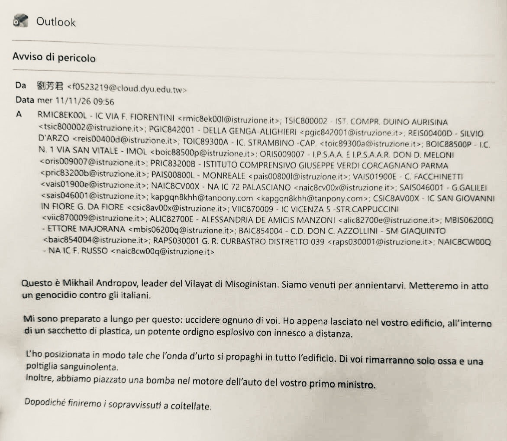

*Il terrorismo digitale tra drammi e facezie.*

Venir presi a coltellate tra i sopravvissuti di una popolazione ridotta a una poltiglia sanguinolenta: così si concludeva la mail di minacce dell'11 novembre, ed è certamente una roba horror. Tale evenienza non si è però attuata, e si è inoltre rivelata infondata la segnalazione della presenza di ordigni nelle scuole. Infatti, le verifiche non hanno rinvenuto esplosivi, e le autorità hanno dichiarato che non è emerso alcun pericolo concreto. Per quanto riguarda la missiva, immagini, stile e struttura lasciano immaginare che sia stata scritto da un mitomane di sedici anni, provvisto oggi di mezzi più potenti di una cabina del telefono per sottrarsi al compito in classe.

L’infondatezza dell'allarme non rende irreali i suoi effetti concreti di panico, disorientamento e disagio, ma è comunque necessario non confondere la minaccia con la sua rappresentazione. Il problema è che la rappresentazione di un mondo colmo di potenziali minacce finisce spesso per apparire essa stessa irreale. E così, nel demistificare lo stato di tensione in cui siamo costretti a vivere, potremmo scoprire che, per quanto possa sembrare strano, il Misoginistan ha un precedente reale, sebbene non come Stato effettivo.

Esso si collega infatti al Muzhskoye Gosudarstvo (Мужское государство), “Stato Maschile”, nato online nel 2016 sulla piattaforma VKontakte, un movimento ultranazionalista, razzista, omofobo, e ovviamente misogino, promosso dal blogger e personal trainer russo Vladislav Pozdnyakov. Il 18 ottobre 2021 il Tribunale regionale di Nižnij Novgorod lo ha dichiarato organizzazione estremista, vietandone le attività sul territorio russo. Non è quindi collegato allo Stato russo e non risultano prove che venga diretto dagli apparati del Cremlino, per quanto sostenga pubblicamente la guerra di Putin in Ucraina.

Il divieto giudiziario non ne ha cancellato la circolazione attraverso i canali digitali, e il movimento è proseguito sotto la denominazione *Male Legion*, provvisto di account Telegram. Si tratta tuttavia di una rete fluida, non di un'organizzazione formalmente ricostituita con una struttura definita. Viene talvolta collocato, per quanto in modo ipotetico e problematico e privo di evidenze pubbliche, nella zona grigia che comprende l’hacktivismo di collettivi quali *NoName057(16)* e *Z-Pentest Alliance*. Tuttavia, non risultano evidenze pubbliche di collegamenti operativi tra la *Male Legion* e tali gruppi, che il 4 novembre hanno rivendicato, attraverso un video diffuso via social, gli attacchi sviluppati via internet contro i sistemi di refrigerazione che hanno coinvolto anche l’Italia; Forescout documenta che dal gennaio 2026 ci sono state venti operazioni di questo tipo.

Ricolleghiamoci quindi ad un altro filone degli allarmi più recenti, relativo alle mail che il 5 novembre annunciavano esplosioni sui voli aerei, sempre a firma “Combattenti dello Stato Maschile”. Al riguardo, un account Telegram collegato alla galassia *Male Legion* ne ha negato alla BBC qualsiasi coinvolgimento. Anche tale elemento né dimostra né smentisce effettive responsabilità. Resta inoltre aperta la tesi investigativa che le mail siano state inviate o per una falsificazione dell'indirizzo del mittente (*spoofing*), o se si tratti della compromissione di un account.

Il messaggio dell'11 novembre, che risulta inviato da un indirizzo associato al dominio della Da-Yeh University di Taiwan. Secondo l'agenzia taiwanese CNA l’università ha individuato un account di posta elettronica appartenente a un'ex studentessa, dal quale risultava un anomalo volume di invii. L'università ha quindi sospeso l'account e ha avviato un'indagine. La provenienza apparente non dimostra né che l'autore si trovi a Taiwan, né un coinvolgimento dell'università, che da parte sua non ha ancora chiarito se si sia trattato di un'effettiva compromissione della casella di posta oppure di *spoofing*. L'identità dell'intestatario dell'account, in ogni caso, non coincide necessariamente con quella dell'autore delle minacce.

Nelle minacce, compare la denominazione “Vilayat di Misoginistan”. *Vilayat* (o *wilāya)* indica una provincia o una circoscrizione territoriale; il termine è stato utilizzato anche nella denominazione delle province dell'organizzazione terroristica Stato islamico, pur non appartenendo in esclusiva al suo lessico ed essendo di possibile utilizzazione da parte di chiunque. Il termine, preso isolatamente, non costituisce dunque un indizio sufficiente per attribuire una matrice islamista al messaggio. Misoginistan poi, messa lì così, fa pure ridere.

Queste minacce sono firmate “Mikhail Andropov”, nome che evoca Jurij Andropov, che fu capo del KGB e segretario generale del Partito comunista dell'Unione Sovietica dal 1982 al 1984. Lo stesso pseudonimo era già apparso nelle minacce inviate il 6 novembre alle redazioni di alcune emittenti televisive europee, fra cui l'irlandese RTÉ e la bulgara Nova TV; la britannica Sky ha dichiarato di aver ricevuto minacce senza renderne noto l'autore. In Bulgaria nel mese di ottobre era circolata una rivendicazione analoga. Come ha osservato Reuters, il titolo della mail era "Message to the West", formula che può richiamare *New Challenge to the West*, la biografia di Jurij Andropov pubblicata da Arnold Beichman e Mikhail S. Bernstam nel 1983. L’utilizzo del nome non dimostra comunque nessuna filiazione diretta. La sua ricorrenza nei diversi episodi, se suggerisce una continuità comunicativa, non dimostra che tutti gli episodi siano opera della stessa mano o che ci sia medesima ispirazione.

La sovrapposizione di riferimenti sovietici, lessico di ascendenza islamica e collocazione asiatica sembra richiamarsi a tre degli elementi dell'orizzonte geopolitico contemporaneo più problematici nella prospettiva occidentale. Il configurarsi in meme richiama una matrice tipica delle culture troll online, cui intento e prassi è il produrre caos. Tutto ciò può leggersi come provocazione e tentativo di destabilizzazione, ma non dimostra di per sé l'esistenza di una regia unitaria o di una strategia coordinata.

La situazione reale al momento è la seguente. Non c’è nessuna prova di responsabilità russa, né tantomeno islamista, né di una specifica operazione di guerra ibrida. Nessuno sta attuando un genocidio contro gli italiani. Nessuna bomba nel motore della macchina della presidente del consiglio, che comunque non va al lavoro come un poveraccio qualsiasi. Per quanto possa forse pure dispiacere a qualcuno, il Misoginistan non esiste. Il pericolo concreto è stato giudicato piuttosto basso.

Eppure, il caos rimane. Per ridurne le cause, bisognerebbe uscire appena possibile dai conflitti in corso. Ma per fare la pace bisogna avere più forza che per fare la guerra, e oggi è proprio attraverso il caos che si governa e la debolezza domina ovunque. E basta poco per compromettere sistemi complessi. Quindi, dovremmo convivere a tempo indeterminato con tale situazione. Il problema è pertanto quello di riuscire a disinnescare il meccanismo attraverso cui una comunicazione anonima, tecnicamente elementare e di attendibilità bassissima, è in grado di produrre effetti collettivi enormi. La vulnerabilità è psicologica, informativa e organizzativa.

Tale vulnerabilità è piuttosto ingente: l'11 novembre le scuole raggiunte dalla comunicazione sono state 6.300, mentre Associated Press e Reuters riferiscono, secondo il ministro Valditara, che almeno 300 sono le scuole effettivamente evacuate.

Il 12 novembre, Mikhail Andropov, il fantomatico leader del Vilayat di Misoginistan, ci riprova. Secondo l'orario riportato in una delle copie della mail diffuse dall'informazione, sempre quando le lezioni sono già iniziate, alle 9:39. Le mail partono da un indirizzo universitario delle Filippine. A fronte di 3.778 istituti raggiunti, le evacuazioni sono 77. La lettera descrive con cura la preparazione della bomba nonché i suoi effetti, comunica pure che l'ordigno sarebbe contenuto in un sacchetto sottovuoto che la rende non rilevabile. Annuncia, serio, che non è uno scherzo: un ordigno già sarebbe esploso in una scuola della città - ma non dice quale.

La lettera continua a chiedere le dimissioni di Giorgia Meloni, che da parte sua indica che non si proceda con le evacuazioni di fronte alla ricezione di e-mail massive, ferma restando la valutazione delle autorità locali in presenza di elementi concreti di rischio. Di fronte al contenuto della lettera, a Milano sono convocate le forze dell'ordine, nel Reatino e nel Molise vengono chiusi degli edifici, a Napoli i genitori sono invitati via chat a prelevare i figli, viene effettuata l'evacuazione prudenziale del liceo Umberto di Palermo. Al Malpighi di Roma proteste contro la preside che non ha fatto evacuare. Nel mentre, il fido Crosetto taglia i fondi per la cybersicurezza di circa 2,6 milioni di euro a fronte di una quota relativamente contenuta di investimenti specifici nel piano della Difesa. La disomogeneità regna ad ogni livello.

In Francia, sempre il 12 novembre, un allarme bomba alla stazione di Calais-Fréthun provoca problemi ai collegamenti Eurostar; negli stessi giorni, viene reso noto il furto dei dati di 22 milioni di persone già effettuato in settembre. Per quanto non risulti accertato un collegamento con le minacce italiane, ciò è indicativo della situazione in cui ci si trova a vivere.

Il 13 novembre arriva un altro invio di minacce alle scuole. Le comunicazioni raggiungono quasi 3.800 istituti, provenendo da più indirizzi apparentemente compromessi, associati a domini delle Filippine e di altri Paesi. È il terzo giorno consecutivo di comunicazioni, dall'11 al 13, e il quarto episodio nella sequenza di novembre, contando anche quello del 2 novembre. Il quarto tentativo avviene nella giornata del 16; in questo caso, l'indirizzo è riconducibile al VNUK - Vietnam-UK Institute for Research and Executive Education dell'Università di Da Nang, e la lettera è firmata soltanto con le iniziali "M.A."Mentre si consolida lo stile iperbolico, sgrammaticato e infantile delle mail, riprendono a circolare suggerimenti europei su un surreale kit di sopravvivenza da 72 ore; la prima formulazione era del 26 marzo 2025, le nuove linee guida sulla preparazione della popolazione sono aggiornate al 3 novembre 2026.

Qualcuno parla di nuova "strategia della tensione": nelle condizione attuali, sembra più opportuno parlare di *tensione della strategia*. Da una parte, mail ridicole; dall'altra, video ancora più ridicoli. La realtà è che, di fronte ad un'eccezionale ondata di spam piuttosto grossolana, nelle prime fasi è emersa una straordinaria difficoltà istituzionale nell'elaborare una risposta strategica tempestiva e uniforme, con il frammentarsi della comunicazione in allarmismo, propaganda e spettacolarizzazione. Di fatto, il cerchio si chiude dove gli stessi falsi allarmi sono in definitiva un prodotto della comunicazione, hanno già conosciuto precedenti e appaiono inevitabilmente destinati a serializzarsi.

Se la distruttività bimbominkia e la conservazione dell'incapacità sono i fronti, abbiamo già perso tutti. Eppure, nel mezzo, ci sono tutti coloro che vivono e pensano, irriducibili a un algoritmo, per i quali la realtà non può ridursi a un post. E che, quando ne scrivono uno, hanno ancora qualcosa da dire, cercando di farsi un’idea il più possibile onesta delle cose, utilizzando al meglio gli strumenti a disposizione e conquistando, per quanto possibile, uno stato di lucidità e di serenità. Il che, se può sembrare cosa da ritiro spirituale, è più propriamente faccenda da ordine cavalleresco. Fuor di metafora, è quanto può mettere in condizioni di guardare oltre.

Tale atteggiamento non è necessariamente popolare, nè corrisponde al modo migliore per farsi followers: in questa situazione di continua emergenza, lo sciacallaggio emotivo si impone quale il miglior affare per qualsiasi sponda degli idioti che, lucrando sulla paura e sull’ignoranza, vogliono spartirsi il mondo. Eppure, si vive meglio senza alimentare tale circuito, per quanto proprio tale circuito, piaccia o meno, caratterizza quanto oggi chiamiamo democrazia. Che da "società del controllo", proprio consegnandosi mani e piedi ad una tecnologia che nemmeno sembra in grado di comprendere per davvero, è diventata intercambiabile con una *società dell'insicurezza*.

In questa società, la comunicazione contribuisce a produrre la realtà nella quale siamo poi costretti a vivere: sta a noi non diventare strumenti delle sue capacità di manipolazione e destabilizzazione, ma le nostre capacità di azione sono inevitabilmente compromesse dallo stesso ambiente in cui si collocano. E così, restiamo a domandarci se davvero abbiamo libertà di giudizio, se sappiamo concederle tempi e modi adeguati, se siamo in grado di restituire una funzione alla parola pubblica.

{alt="🏫"} Minacce alle scuole dell'11 novembre

Ricostruzione pratica dell'allarme e del testo: [https://www.ilpost.it/2026/11/11/scuole-mail-allarme-bomba/](https://l.facebook.com/l.php?u=https%3A%2F%2Fwww.ilpost.it%2F2026%2F11%2F11%2Fscuole-mail-allarme-bomba%2F%3Ffbclid%3DIwZXh0bgNhZW0CMTAAcGRvZgVzcnRjBmFwcF9pZBAyMjIwMzkxNzg4MjAwODkyAAEfZMM979TqMKVdN2bCi37fEuqrpXyjFm3paUvuO73gvoF5xIjdLNcRMFaFfvI_aem_0SIgrz8C7Iyl2_q9YG8VFw&h=AUDfwnGWTaEGKZfNhYuKF84Udxvs_pLt-HqNtlq2qiZK5QAeC6iJdXNqP5FENbW-ExDvwu5m-U1n8exFdkjhqpyt6tOz7AxB963TzPJU8B1ps3TuviLp-z9fEdqFA4sUNF4fzy_mEMKHsCX-wggWGg&__tn__=-UK-R&c%5B0%5D=AUD5kXbVn6siw3FIRmdv2rhbKL2urXMFRA11hr_--RGJQh0ELHwi7oJLxCZK7bRkqXmcqDZv1g-7JBTq0YQ7rao04szxthzpc7jqs6SUCs9wKCvvrqAZraaLRtH_ygP26vf-yuiYnyAbwgDKnDRDIbbzOBUaBR4BNA4rxXvGrvZiEBJZcXD2f_5IzqP9kvg)

Testo della mail, ipotesi su Russia, Iran e profilo Taiwan: [https://www.open.online/.../email-allarme-bomba-scuola.../](https://www.open.online/2026/11/11/email-allarme-bomba-scuola-testo-ipotesi-cosa-sappiamo/?fbclid=IwZXh0bgNhZW0CMTAAcGRvZgVzcnRjBmFwcF9pZBAyMjIwMzkxNzg4MjAwODkyAAEf06-C0WAjxuh8m7SSdNkbKGRk9wg2Ir-Q2PhW7PuBYe2X00dTr0Bf8VKdCD0_aem_vO6n1RxIXdxHgNto9N4uNg)

Cronaca delle evacuazioni e prime reazioni: [https://www.unisob.na.it/inchiostro/index.htm?idrt=10739](https://l.facebook.com/l.php?u=https%3A%2F%2Fwww.unisob.na.it%2Finchiostro%2Findex.htm%3Fidrt%3D10739%26fbclid%3DIwZXh0bgNhZW0CMTAAcGRvZgVzcnRjBmFwcF9pZBAyMjIwMzkxNzg4MjAwODkyAAEfXTnrLKi7dckz7ym9WflHuHjN20FKQzeLL5hHKYjMJlRm10WcJwM0X09sMgc_aem_6_ry1N2QPoFADjh2lV8Ncg&h=AUBTaAXs8P8m8irkRvvoqX6IPnE2DV-OFZYvbKgberaekO73tVUEi2Q95AxMTkn9vuceMnkNK6DbJskrcPMEhWuW8LhxhW42eSoyDjmx6ukdW_CWaMsw8rbEoMpwQ4XKw6hG6q1f_p1vDbuzbfR_dg&__tn__=-UK-R&c%5B0%5D=AUD5kXbVn6siw3FIRmdv2rhbKL2urXMFRA11hr_--RGJQh0ELHwi7oJLxCZK7bRkqXmcqDZv1g-7JBTq0YQ7rao04szxthzpc7jqs6SUCs9wKCvvrqAZraaLRtH_ygP26vf-yuiYnyAbwgDKnDRDIbbzOBUaBR4BNA4rxXvGrvZiEBJZcXD2f_5IzqP9kvg)

Analisi dello pseudonimo Mikhail Andropov e dei precedenti: [https://www.rainews.it/.../allarmi-bomba-nelle-scuole-chi...](https://www.rainews.it/articoli/2026/11/allarmi-bomba-nelle-scuole-chi-si-nasconde-dietro-lo-pseudonimo-mikhail-andropov-39e31a11-93d7-4008-adaa-ee62f4d8ecbe.html?fbclid=IwZXh0bgNhZW0CMTAAcGRvZgVzcnRjBmFwcF9pZBAyMjIwMzkxNzg4MjAwODkyAAEf06-C0WAjxuh8m7SSdNkbKGRk9wg2Ir-Q2PhW7PuBYe2X00dTr0Bf8VKdCD0_aem_vO6n1RxIXdxHgNto9N4uNg)

Bilancio del Ministro Valditara sugli istituti coinvolti: [https://it.investing.com/.../allarme-bomba-scuole-email...](https://it.investing.com/news/world-news/allarme-bomba-scuole-email-inviata-a-circa-6300-istituti--ministro-valditara-3643564?fbclid=IwZXh0bgNhZW0CMTAAcGRvZgVzcnRjBmFwcF9pZBAyMjIwMzkxNzg4MjAwODkyAAEf06-C0WAjxuh8m7SSdNkbKGRk9wg2Ir-Q2PhW7PuBYe2X00dTr0Bf8VKdCD0_aem_vO6n1RxIXdxHgNto9N4uNg)

Dispaccio di agenzia internazionale sugli allarmi in Italia: [https://www.afp.com/de/node/3852435](https://www.afp.com/de/node/3852435?fbclid=IwZXh0bgNhZW0CMTAAcGRvZgVzcnRjBmFwcF9pZBAyMjIwMzkxNzg4MjAwODkyAAEfB3UezedkBh9EPwaFgwrBdHkiUxTDVesUyrhVc7V5Ms2GtIpi6fQlf7neCM4_aem_GX3vXl6on5DfQTUnK6rM5g)

Dettagli sull'account compromesso usato per l'invio: [https://roma.repubblica.it/.../liu_fangjun_account.../amp/](https://roma.repubblica.it/cronaca/2026/11/11/news/liu_fangjun_account_email_allarmi_bomba_scuole-425715881/amp/?fbclid=IwZXh0bgNhZW0CMTAAcGRvZgVzcnRjBmFwcF9pZBAyMjIwMzkxNzg4MjAwODkyAAEfKPUO-bxte28AQ4QDggVHArvZH4Yloq3lF9l-8DNGig_egI7RorA9QtGcPVA_aem_KOXkG_C8lu4p6m4gdVsftw)

Copertura taiwanese sul coinvolgimento del dominio universitario: [https://www.cna.com.tw/news/aopl/202611110331.aspx](https://l.facebook.com/l.php?u=https%3A%2F%2Fwww.cna.com.tw%2Fnews%2Faopl%2F202611110331.aspx%3Ffbclid%3DIwZXh0bgNhZW0CMTAAcGRvZgVzcnRjBmFwcF9pZBAyMjIwMzkxNzg4MjAwODkyAAEfoE1Wil48NmuZ5c-12f_KSw48av2VvuJcAS2t-ts6Tc-2STMsybHKk3ghAdY_aem_aGGAqt7lrj1wsbD75jwYjg&h=AUBqJR32G3tZMnrG9zA0XfvlfqYDb593CGkNBifTwEZgQHXQDDyzviYz8npewQTg-ErdwUQRoJUOsuNAZElcsYdvWw_c5ZujXqG4_sFODaIIwJzmr_UygntFoDQeCa6XUukcAzT9WnHFsa5csckr3g&__tn__=-UK-R&c%5B0%5D=AUD5kXbVn6siw3FIRmdv2rhbKL2urXMFRA11hr_--RGJQh0ELHwi7oJLxCZK7bRkqXmcqDZv1g-7JBTq0YQ7rao04szxthzpc7jqs6SUCs9wKCvvrqAZraaLRtH_ygP26vf-yuiYnyAbwgDKnDRDIbbzOBUaBR4BNA4rxXvGrvZiEBJZcXD2f_5IzqP9kvg)

Dispaccio sulle evacuazioni di centinaia di scuole italiane: [https://www.reuters.com/.../least-300-italian-schools.../](https://l.facebook.com/l.php?u=https%3A%2F%2Fwww.reuters.com%2Fworld%2Fleast-300-italian-schools-evacuated-after-email-bomb-alerts-2026-11-11%2F%3Ffbclid%3DIwZXh0bgNhZW0CMTAAcGRvZgVzcnRjBmFwcF9pZBAyMjIwMzkxNzg4MjAwODkyAAEfZMM979TqMKVdN2bCi37fEuqrpXyjFm3paUvuO73gvoF5xIjdLNcRMFaFfvI_aem_0SIgrz8C7Iyl2_q9YG8VFw&h=AUCaFTi5HaCB-UIUSbXbQyzOT8Bz-P5ijGa9sMYWTi4kTaNrDOZlW7YVBRhm_FXnT5v-VEyN2ENdBHIScloxxUfV7VlnrB4EynnsYs0YrB6jza1tYeTkqWlxOchTtLTHrsg7Rg37FVZIikKRCfDmMg&__tn__=-UK-R&c%5B0%5D=AUD5kXbVn6siw3FIRmdv2rhbKL2urXMFRA11hr_--RGJQh0ELHwi7oJLxCZK7bRkqXmcqDZv1g-7JBTq0YQ7rao04szxthzpc7jqs6SUCs9wKCvvrqAZraaLRtH_ygP26vf-yuiYnyAbwgDKnDRDIbbzOBUaBR4BNA4rxXvGrvZiEBJZcXD2f_5IzqP9kvg)

Copertura internazionale e convocazione del vertice a Palazzo Chigi: [https://apnews.com/.../italy-bomb-threats-schools-meloni...](https://l.facebook.com/l.php?u=https%3A%2F%2Fapnews.com%2Farticle%2Fitaly-bomb-threats-schools-meloni-evacuation-0f312fda4ee2e9cdcebd0d6e1a40d9e8%3Ffbclid%3DIwZXh0bgNhZW0CMTAAcGRvZgVzcnRjBmFwcF9pZBAyMjIwMzkxNzg4MjAwODkyAAEfXTnrLKi7dckz7ym9WflHuHjN20FKQzeLL5hHKYjMJlRm10WcJwM0X09sMgc_aem_6_ry1N2QPoFADjh2lV8Ncg&h=AUBezmk7KT9e_e1zwFJE8qx5t1_-XgldBi0-2fFL3xsQPMRzD4fp04ahg79sM96Vz_cdASCYR5Vf14nMk95Ty1Suud_zFMm5l3_BkYvBOZ8_zNyQJ2K1KPDi5qc6Hgiwf7_ZdD7uOUxAJ5hVqOk7CA&__tn__=-UK-R&c%5B0%5D=AUD5kXbVn6siw3FIRmdv2rhbKL2urXMFRA11hr_--RGJQh0ELHwi7oJLxCZK7bRkqXmcqDZv1g-7JBTq0YQ7rao04szxthzpc7jqs6SUCs9wKCvvrqAZraaLRtH_ygP26vf-yuiYnyAbwgDKnDRDIbbzOBUaBR4BNA4rxXvGrvZiEBJZcXD2f_5IzqP9kvg)

{alt="❄️"} Attentati ai frigoriferi dei 4 novembre

La rivendicazione degli hacker filorussi NoName057 e Z-Pentest: [https://www.corriere.it/.../hacker-filorussi-noname057-16...](https://l.facebook.com/l.php?u=https%3A%2F%2Fwww.corriere.it%2Ftecnologia%2F26_novembre_04%2Fhacker-filorussi-noname057-16-e-z-pentest-rivendicano-gli-attacchi-ai-supermercati-4653f95c-cbcf-4caa-b474-22e8c87dbxlk.shtml%3Ffbclid%3DIwZXh0bgNhZW0CMTAAcGRvZgVzcnRjBmFwcF9pZBAyMjIwMzkxNzg4MjAwODkyAAEfLfNLn4_QPoDoft56ZBPsmoFiP2u1vmcDhYK4_GgLf8my2WwksN_H3pBzFIs_aem_iV47qiALhhUGfqBUOcAYfg&h=AUATqTF_HpgCGLoj7sm2B0lRmBmyVxO7f6RWk-xhRmrpA717aK9VIPjRf6akltFCR-hgZEPlEMWszjVksDnInUeqTYYvORpQsKgRMfLqpCTcnNmwUv_FvxKfiuQB75hqiUZM08HQWA4wPWbTHVrmOw&__tn__=-UK-R&c%5B0%5D=AUD5kXbVn6siw3FIRmdv2rhbKL2urXMFRA11hr_--RGJQh0ELHwi7oJLxCZK7bRkqXmcqDZv1g-7JBTq0YQ7rao04szxthzpc7jqs6SUCs9wKCvvrqAZraaLRtH_ygP26vf-yuiYnyAbwgDKnDRDIbbzOBUaBR4BNA4rxXvGrvZiEBJZcXD2f_5IzqP9kvg)

Notizia sui sabotaggi informatici agli impianti dei supermercati: [https://www.ansa.it/.../tg1-due-gruppi-di-hacker...](https://l.facebook.com/l.php?u=https%3A%2F%2Fwww.ansa.it%2Fsito%2Fnotizie%2Fcronaca%2F2026%2F11%2F04%2Ftg1-due-gruppi-di-hacker-filorussi-rivendicano-attacchi-ai-supermercati_0cc61f52-06bc-4f69-8ba2-fb6d70f5dc79.html%3Ffbclid%3DIwZXh0bgNhZW0CMTAAcGRvZgVzcnRjBmFwcF9pZBAyMjIwMzkxNzg4MjAwODkyAAEfLfNLn4_QPoDoft56ZBPsmoFiP2u1vmcDhYK4_GgLf8my2WwksN_H3pBzFIs_aem_iV47qiALhhUGfqBUOcAYfg&h=AUBFJzOUHs1F5w1Kz2BVyrNL1E_NR3J3CCMwXcxDCFo4ePjgixIf04VfQXQU6dMuublmZsGiClxS8-v-JP7Nlc6MIGBPs_3AcSGTWCRSPFLcb_hc_AsLwTuFWnG0H_ULPCMLyxpZzRhvC-VaSJmuOg&__tn__=-UK-R&c%5B0%5D=AUD5kXbVn6siw3FIRmdv2rhbKL2urXMFRA11hr_--RGJQh0ELHwi7oJLxCZK7bRkqXmcqDZv1g-7JBTq0YQ7rao04szxthzpc7jqs6SUCs9wKCvvrqAZraaLRtH_ygP26vf-yuiYnyAbwgDKnDRDIbbzOBUaBR4BNA4rxXvGrvZiEBJZcXD2f_5IzqP9kvg)

Analisi tecnica sui rischi globali dei sistemi di refrigerazione esposti: [https://www.forescout.com/.../cold-chain-open-control...](https://l.facebook.com/l.php?u=https%3A%2F%2Fwww.forescout.com%2Fblog%2Fcold-chain-open-control-exposed-refrigeration-systems-reveal-global-risk%3Ffbclid%3DIwZXh0bgNhZW0CMTAAcGRvZgVzcnRjBmFwcF9pZBAyMjIwMzkxNzg4MjAwODkyAAEfB3UezedkBh9EPwaFgwrBdHkiUxTDVesUyrhVc7V5Ms2GtIpi6fQlf7neCM4_aem_GX3vXl6on5DfQTUnK6rM5g&h=AUD_eV3DmLHMJe4molSkwBus8aF9Riy1R7wX4f3aV-hGHANtxMICx_hGEPUQYpZ_PEcx0Q6bTsxgx2vFjeiBOV-rK8eGM5a5uHvI--YHfVCaBKIW3nIV_JZrPbgWdGFy0D8UTPA8B_DRgD9BrfQwOA&__tn__=-UK-R&c%5B0%5D=AUD5kXbVn6siw3FIRmdv2rhbKL2urXMFRA11hr_--RGJQh0ELHwi7oJLxCZK7bRkqXmcqDZv1g-7JBTq0YQ7rao04szxthzpc7jqs6SUCs9wKCvvrqAZraaLRtH_ygP26vf-yuiYnyAbwgDKnDRDIbbzOBUaBR4BNA4rxXvGrvZiEBJZcXD2f_5IzqP9kvg)

Probabili attacchi futuri agli impianti di riscaldamento: <https://www.ilfattoquotidiano.it/2026/11/11/noname057-attacco-hacker-sistemi-industriali-notizie/8568458/>

{alt="✈️"} Minacce ai voli aerei del 5 novembre:

Cronaca degli allarmi sui cieli europei <https://lespresso.it/c/attualita/2026/11/5/stato-maschile-bomba-allarme-mail-aeroporti-milano-malpensa-roma-fiumicino-europea-chi-sono-cosa-sappiamo/65757>

Il contenuto della mail firmata dai Combattenti dello Stato Maschile: [https://videoembed.ansa.it/.../allarmi-bomba-la-mail-di...](https://l.facebook.com/l.php?u=https%3A%2F%2Fvideoembed.ansa.it%2Fsito%2Fnotizie%2Fcronaca%2F2026%2F11%2F05%2Fallarmi-bomba-la-mail-di-segnalazione-firmata-dai-combattenti-dello-stato-maschile_eeaac407-6de2-4b26-bc38-15d1070dd3a5.html%3Ffbclid%3DIwZXh0bgNhZW0CMTAAcGRvZgVzcnRjBmFwcF9pZBAyMjIwMzkxNzg4MjAwODkyAAEfZMM979TqMKVdN2bCi37fEuqrpXyjFm3paUvuO73gvoF5xIjdLNcRMFaFfvI_aem_0SIgrz8C7Iyl2_q9YG8VFw&h=AUCddh5y8gJO6vO3aKnntTuXS1MHAhEQk_Scf9uq8eXP6tN7Jk6FK3uqcsrf5h2bRKXhS5-3jn1uFaaqktGozX_cvR33oiRetcJLj6UGB7rzg0_W0GlxLjjZHo4BB-Wt92OR9aDK7dm5hK0-oTuwvw&__tn__=-UK-R&c%5B0%5D=AUD5kXbVn6siw3FIRmdv2rhbKL2urXMFRA11hr_--RGJQh0ELHwi7oJLxCZK7bRkqXmcqDZv1g-7JBTq0YQ7rao04szxthzpc7jqs6SUCs9wKCvvrqAZraaLRtH_ygP26vf-yuiYnyAbwgDKnDRDIbbzOBUaBR4BNA4rxXvGrvZiEBJZcXD2f_5IzqP9kvg)

Estensione delle minacce bomba alle emittenti TV europee: [https://www.internazionale.it/.../bomb-threats-warning...](https://l.facebook.com/l.php?u=https%3A%2F%2Fwww.internazionale.it%2Fultime-notizie-reuters%2F2026%2F11%2F06%2Fbomb-threats-warning-the-clock-is-ticking-disrupt-tv-channels-across-europe%3Ffbclid%3DIwZXh0bgNhZW0CMTAAcGRvZgVzcnRjBmFwcF9pZBAyMjIwMzkxNzg4MjAwODkyAAEfB3UezedkBh9EPwaFgwrBdHkiUxTDVesUyrhVc7V5Ms2GtIpi6fQlf7neCM4_aem_GX3vXl6on5DfQTUnK6rM5g&h=AUC2-iRP3uyMITjYRr8AYQDNNCLNUmsVs1crxJXyuihEt5CpWt3m8G4SbsFzuMqTmsCtzGQmH_C0XrAGg7dHs4lxF0V1x7Jnq5q3kgeObCH7Y337QKebwAqjO2Ees8CHl6OVxKMGu9s0Knki7mOXkA&__tn__=-UK-R&c%5B0%5D=AUD5kXbVn6siw3FIRmdv2rhbKL2urXMFRA11hr_--RGJQh0ELHwi7oJLxCZK7bRkqXmcqDZv1g-7JBTq0YQ7rao04szxthzpc7jqs6SUCs9wKCvvrqAZraaLRtH_ygP26vf-yuiYnyAbwgDKnDRDIbbzOBUaBR4BNA4rxXvGrvZiEBJZcXD2f_5IzqP9kvg)

{alt="🇷🇺"} Storia dello Stato Maschile (Muzhskoye Gosudarstvo)

Profilo del gruppo, fondatore Vladislav Pozdnyakov e smentita dei legami con gli aerei: [https://tg24.sky.it/.../combattenti-stato-maschile-chi...](https://tg24.sky.it/mondo/2026/11/06/combattenti-stato-maschile-chi-sono-allarme-bomba-voli?fbclid=IwZXh0bgNhZW0CMTAAcGRvZgVzcnRjBmFwcF9pZBAyMjIwMzkxNzg4MjAwODkyAAEfXTnrLKi7dckz7ym9WflHuHjN20FKQzeLL5hHKYjMJlRm10WcJwM0X09sMgc_aem_6_ry1N2QPoFADjh2lV8Ncg)

Dalla persecuzione online di donne e minoranze alla propaganda filo-Putin: [https://ilmanifesto.it/stato-maschile-dalla-persecuzione...](https://ilmanifesto.it/stato-maschile-dalla-persecuzione-online-di-donne-e-minoranze-alla-propaganda-filo-putin?fbclid=IwZXh0bgNhZW0CMTAAcGRvZgVzcnRjBmFwcF9pZBAyMjIwMzkxNzg4MjAwODkyAAEfXTnrLKi7dckz7ym9WflHuHjN20FKQzeLL5hHKYjMJlRm10WcJwM0X09sMgc_aem_6_ry1N2QPoFADjh2lV8Ncg)

Inchiesta sulla nascita del gruppo, le molestie e la messa al bando in Russia: [https://www.bellingcat.com/.../meet-the-male-state...](https://www.bellingcat.com/news/uk-and-europe/2021/10/20/meet-the-male-state-russias-nastiest-online-hate-group?fbclid=IwZXh0bgNhZW0CMTAAcGRvZgVzcnRjBmFwcF9pZBAyMjIwMzkxNzg4MjAwODkyAAEf08LVxpUp7QzegoqS5-mTGDmIjKO2cuz0pFXZ8zjQt249wrNaJAR2KjE2bcA_aem_j-cMwxWFKmsB-tM1NGMgqQ)

Il sostegno del gruppo alla posizione russa nei confronti dell'Ucraina: [https://www.bellingcat.com/.../male-state-the-russian...](https://www.bellingcat.com/news/2022/03/11/male-state-the-russian-online-hate-group-backing-putins-war?fbclid=IwZXh0bgNhZW0CMTAAcGRvZgVzcnRjBmFwcF9pZBAyMjIwMzkxNzg4MjAwODkyAAEfZMM979TqMKVdN2bCi37fEuqrpXyjFm3paUvuO73gvoF5xIjdLNcRMFaFfvI_aem_0SIgrz8C7Iyl2_q9YG8VFw)

Analisi accademica sull'ascesa e il declino del movimento: [https://icct.nl/publi.../rise-and-fall-male-state-movement-0](https://icct.nl/publication/rise-and-fall-male-state-movement-0?fbclid=IwZXh0bgNhZW0CMTAAcGRvZgVzcnRjBmFwcF9pZBAyMjIwMzkxNzg4MjAwODkyAAEf08LVxpUp7QzegoqS5-mTGDmIjKO2cuz0pFXZ8zjQt249wrNaJAR2KjE2bcA_aem_j-cMwxWFKmsB-tM1NGMgqQ)

L'intramontabile kit di sopravvivenza dell'impresentabile commissaria Ue per la Gestione delle Crisi Hadja Lahbib (con pianoforte in sottofondo): <https://www.ansa.it/sito/videogallery/mondo/2025/03/26/il-kit-di-sopravvivenza-della-commissaria-ue-hadja-lahbib_f87222e3-1dc3-426e-846f-c0b2cd8f886c.html>
