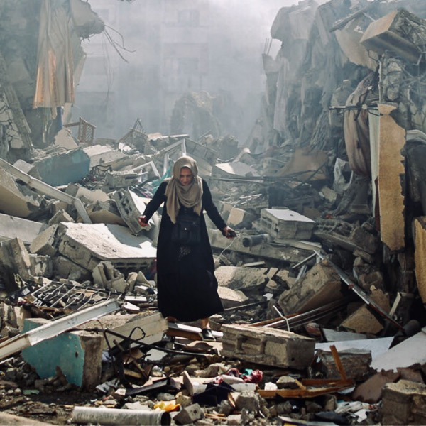

*Contrasto all'antisemitismo e iniziative umanitarie in Italia. Composizioni parlamentari e alleanze politiche in Israele. Tradizioni ebraiche e contraddizioni contemporanee. Le vicende di una striscia di terra.*

## 1. La discussione in Italia

La legge recante *Disposizioni per il contrasto all'antisemitismo e per l'adozione della definizione operativa di antisemitismo* (A.S. 1004/ A.C. 2830), approvata in via definitiva dalla Camera dei Deputati il 17 novembre 2026, recepisce la definizione operativa di antisemitismo elaborata dall'Alleanza internazionale per la memoria dell'Olocausto (IHRA). Pertanto, «*una determinata percezione degli ebrei che può essere espressa come odio nei loro confronti*» viene assunta quale riferimento per l'applicazione della legge. Il testo, composto da cinque articoli, istituisce una Strategia nazionale triennale, prevede Linee d'azione in materia di formazione, informazione e monitoraggio, introduce la figura di un Coordinatore nazionale e un Gruppo tecnico di lavoro; non introduce nuovi reati o nuove sanzioni e non prevede nuovi oneri finanziari.

Le disposizioni sono passate con 147 voti favorevoli, 93 contrari e 5 astenuti su 245 deputati votanti, registrando una forte divisione nell'opposizione. I partiti contrari (M5S, AVS, la maggioranza del PD) contestano la mancata approvazione degli emendamenti volti a esplicitare che la critica politica al governo israeliano non costituisce antisemitismo. Da parte sua, il provvedimento all'articolo 1 richiama espressamente il rispetto delle libertà costituzionali, di critica e di espressione; eppure, il rischio concreto è che una definizione operativa, trasferita in ambito istituzionale, scolastico e culturale, finisca per produrre un effetto dissuasivo sulla libera discussione politica.

Nel PD, l'uscita di Emanuele Fiano dal partito è stata motivata proprio dal dissenso verso il voto contrario del partito a una norma ritenuta da lui indispensabile per colmare un vuoto legislativo e contrastare l'odio antiebraico. La frattura attraversa l'intero centrosinistra, dove una parte dei parlamentari del PD ha preso le distanze dalla linea della segreteria, astenendosi o non seguendone le indicazioni. Amnesty International Italia e altre organizzazioni per i diritti civili parlano invece di una legge lesiva della libertà di espressione.

Dopo l'approvazione, il Coordinamento No DDL Antisemitismo ha chiesto al Presidente della Repubblica di non promulgare il provvedimento. La senatrice a vita Liliana Segre aveva auspicato un'approvazione unanime, dichiarandosi disponibile anche a modifiche condivise. Ulteriori modifiche parlamentari appaiono ormai improponibili: il confronto si sposta sulla promulgazione e sull'esercizio delle prerogative costituzionali del Capo dello Stato.

Sul fronte umanitario, Raniero La Valle, Andrea Riccardi e Gustavo Zagrebelsky hanno lanciato un appello al governo italiano perché promuova una missione di soccorso a Gaza, con l'invio di «*unità della Marina militare disarmate*» per assistere la popolazione colpita dalle recenti alluvioni. La proposta tende a sottrarre l'intervento umanitario alle contrapposizioni politiche per ricondurlo a una responsabilità elementare di soccorso. Sembra però quasi dimenticare che l'emergenza dipenda soprattutto dallo stato di guerra e che le stesse conseguenze delle alluvioni si aggravino in una condizione di distruzione delle infrastrutture, di sfollamento e di privazione dei mezzi essenziali di sopravvivenza.

## 2. Israele dopo il voto

Israele attraversa una fase di profonda instabilità politica e di stallo post-elettorale. L'ex capo di Stato Maggiore Gadi Eisenkot, leader di Yashar!, ha ricevuto dal presidente Isaac Herzog l'incarico di formare un nuovo governo di coalizione volto al cambiamento. Alla Knesset, su un totale di 120 parlamentari, il blocco di Benjamin Netanyahu conta 53 seggi, quello di Eisenkot 48 e i partiti arabi 19.

Le trattative restano complesse perché nessuno dei due schieramenti dispone autonomamente della maggioranza assoluta, fissata a 61 seggi. I numeri rendono indispensabile il sostegno, o quantomeno l'astensione, di forze esterne ai due schieramenti principali.

Eisenkot potrebbe tentare due strade, entrambe complicate: formare un governo di minoranza sostenuto dall'esterno dai partiti arabi, oppure cercare un'intesa con i partiti ultraortodossi, in particolare Shas e Giudaismo Unito della Torah, che dispongono complessivamente di tredici seggi. Il Partito Sionista Religioso di Bezalel Smotrich dispone invece di sei seggi e appartiene al blocco di Netanyahu.

Qualora Eisenkot non riuscisse a formare il governo, Netanyahu potrebbe ricevere a sua volta l'incarico di formarlo, tentando anche di attrarre parlamentari provenienti dagli schieramenti avversari. La sua permanenza al potere, tuttavia, non è più sostenuta da una maggioranza parlamentare autonoma.

Una prima prova si è consumata il 17 novembre, con l'elezione di Matan Kahana, esponente di Yashar!, alla presidenza della Knesset. Kahana ha ottenuto 66 voti, grazie anche al sostegno delle due formazioni arabe, Lista Comune (Joint List) e Ra'am (Lista Araba Unita), che dispongono complessivamente di 19 seggi, uno dei cui parlamentari non ha partecipato alla votazione, prevalendo sul candidato del Likud.

La votazione ha reso evidente che il contributo delle forze arabe può risultare decisivo non soltanto nella formazione del governo, ma anche nella composizione degli organi istituzionali. Proprio la possibilità che esse assumano ruoli nelle vicepresidenze parlamentari è stata contestata dal blocco di Netanyahu, che ha cercato di impedirne l'inserimento nelle cariche della Knesset.

## 3. Arabi, palestinesi e nuove alleanze

Anche sulla gestione del conflitto le visioni divergono. L'esecutivo uscente intende proseguire le operazioni militari e mantenere il controllo strategico della Striscia. Da parte sua, Eisenkot propone di fissare in diciotto mesi, a partire dall'eventuale insediamento del nuovo governo, il termine per porre fine al governo di Hamas e smantellarne la struttura militare, attraverso il quadro negoziale promosso da Trump o, se necessario, attraverso il ricorso alla forza. L'eventuale avvio di un'amministrazione tecnocratica appartiene invece a un più ampio quadro di transizione internazionale previsto per Gaza.

«*L'unica unità possibile deve includere ebrei, arabi, drusi, religiosi e laici*», ha dichiarato lo stesso Eisenkot. Sulla stessa linea di opposizione al premier uscente si muove Yair Golan, leader dei Democratici: «*Che Netanyahu resti al potere è fuori discussione*», ha affermato, esprimendo il timore che l'ex primo ministro possa trascinare Israele in un nuovo conflitto con l'Iran per assicurarsi la propria sopravvivenza politica. Golan difende inoltre il coinvolgimento dei partiti arabi nella vita istituzionale, pur ribadendo la netta esclusione di *Hamas*. La distinzione è importante: la rappresentanza politica dei cittadini arabi di Israele non può essere confusa con il sostegno all'organizzazione islamista che governa la Striscia di Gaza.

Nei Territori palestinesi, intanto, non si tengono elezioni legislative e presidenziali generali da oltre vent'anni. Le ultime elezioni legislative risalgono al 2006, quelle presidenziali al 2005. Il presidente dell'Autorità Nazionale Palestinese, Abu Mazen, ha fissato il voto all'11 settembre 2027, giustificando i continui rinvii con le difficili condizioni di sicurezza e le restrizioni israeliane, le difficoltà di accesso a Gaza e a Gerusalemme Est e gli ostacoli amministrativi ed economici che impediscono il regolare svolgimento delle consultazioni. Per partecipare alla tornata elettorale, le forze politiche dovranno impegnarsi a riconoscere l'OLP quale unico rappresentante del popolo palestinese e a sottoscriverne esplicitamente il programma politico e nazionale, insieme agli impegni internazionali dell'Organizzazione.

Sul piano delle testimonianze e del dibattito internazionale, infine, fanno discutere le dure parole di Mosab Hassan Yousef, figlio di uno dei fondatori di Hamas, già militante dell'organizzazione e successivamente collaboratore dei servizi israeliani. Nel condannare gli attacchi del 7 ottobre, Yousef ha sostenuto che, secondo gli islamisti, una parte consistente della sinistra europea sarebbe composta da quelli che definiscono «*utili idioti*»: interlocutori democratici che, in nome dell'inclusione, finiscono per sottovalutare la natura e le finalità dei movimenti islamisti.

## 4. La terra e la promessa

Senza equiparare la politica israeliana al nazismo né negare il diritto all'autodeterminazione del popolo ebraico, possiamo e dobbiamo contestare la pretesa del moderno Stato di Israele di rappresentare in via esclusiva il significato della Terra promessa, che appartiene alla storia e alla tradizione dell'ebraismo.

«*La terra è mia e voi siete presso di me come forestieri e ospiti*» (Levitico 25,23): la terra non è proprietà assoluta di un popolo, ma appartiene a Dio; chi la abita è, in ultima istanza, ospite e custode. Nella tradizione biblica, la terra non è soltanto un'eredità o un luogo di appartenenza: è anche uno spazio nel quale un popolo è chiamato a misurarsi con la propria legge, con la giustizia e con la responsabilità verso gli altri. La promessa non è separabile dal patto e dagli obblighi morali che lo accompagnano. Da questo punto di vista, è inevitabile constatare quanto l'occupazione forzata, la subordinazione di un'altra popolazione e la negazione dei suoi diritti ne tradiscano lo spirito.

Che cosa si trasmette di un continuo mettersi alla prova al cristianesimo, all'islam e alla nostra stessa laicità? Sappiamo esporci alle difficoltà? Abbiamo una coscienza? Che cosa facciamo per gli altri? E, soprattutto, Israele è ancora in grado di essere testimone di quei valori ai quali la sua stessa tradizione religiosa e culturale dovrebbe richiamarlo?

Nel confrontarci con le altre disposizioni del Ddl, non è una novità che le scuole trasmettano i codici del potere dominante. È sempre accaduto, in forme diverse, che l'istruzione rispecchiasse le categorie culturali e politiche prevalenti. Il problema non è trasmettere conoscenze, né tantomeno affrontare l'importante studio della storia dell'antisemitismo e della *Shoah*. Il problema nasce quando una definizione istituzionale rischia di diventare una lettura obbligatoria che sottrae alla discussione proprio ciò che dovrebbe essere oggetto di analisi e di confronto.

L'importante è quindi che venga tutelata la capacità di mettere in discussione questi codici e che niente possa costringerci a negare l'evidenza. La libertà di insegnamento, di ricerca e di critica non è un ostacolo alla lotta contro l'antisemitismo: ne è piuttosto una condizione essenziale, come lo è nei confronti di ogni altro pregiudizio. Tale responsabilità coinvolge ciascuno di noi e, nonostante tutto, possiamo e dobbiamo dire sempre meglio quanto c'è davvero da dire, anche quando il disinteresse e l'impotenza riguardano quanto è più terribile. Come Gaza. Nessuno può essere denunciato per questo.

## 5. Breve storia di Gaza

La regione di Gaza costituisce da millenni uno snodo strategico e commerciale lungo la via costiera tra Egitto e Levante. Integrata per quattro secoli nell'Impero Ottomano, dopo la Grande Guerra passò sotto l'amministrazione britannica e rientrò nel Mandato della Palestina. Nel 1947 la Risoluzione ONU 181 prevedeva di includerla nello Stato arabo di Palestina, ma il piano di partizione non fu attuato, anche a causa della guerra civile che precedette e accompagnò la fine del Mandato. Oltre 200.000 profughi palestinesi, in fuga o espulsi dalle aree entrate a far parte di Israele, si riversarono nell'area, portandone la popolazione da circa 80.000 a oltre 280.000 abitanti, più che triplicandola in pochi mesi. Per accoglierli furono allestiti otto campi profughi ufficiali, tra cui Jabaliya, Khan Yunis e Rafah.

L'Egitto non annesse mai la Striscia di Gaza. Nel settembre 1948 aveva promosso la costituzione del Governo di tutta la Palestina, con sede iniziale a Gaza, ma il suo ruolo fu presto svuotato di effettivi poteri e i suoi membri si trasferirono al Cairo; il governo venne formalmente sciolto nel 1959. Il governo militare egiziano non concesse alla popolazione la cittadinanza egiziana e impose un regime di amministrazione militare e restrizioni alla circolazione. Fu l'armistizio israelo-egiziano del 24 febbraio 1949 a definire i confini dell'entità territoriale che avrebbe assunto il nome di Striscia di Gaza.

Nel quadro della crisi di Suez, Israele occupò la Striscia di Gaza e il Sinai nell'autunno del 1956. L'operazione militare israeliana, avviata il 29 ottobre nel Sinai e seguita dall'occupazione di Gaza il 3 novembre, si inseriva nell'attacco congiunto di Francia, Regno Unito e Israele contro l'Egitto. Le tensioni di confine e le incursioni dei *fedayeen* palestinesi sostenuti dall'Egitto costituivano parte del contesto del conflitto, ma non ne esaurivano le cause. Israele si ritirò dai territori occupati l'8 marzo 1957, sotto la pressione internazionale, in particolare di Stati Uniti e Unione Sovietica, e nel quadro dell'intervento delle Nazioni Unite.

Nel giugno 1967 Israele sconfisse Egitto, Giordania e Siria nella Guerra dei Sei Giorni e conquistò la Striscia di Gaza insieme alla penisola del Sinai, alla Cisgiordania, a Gerusalemme Est e alle alture del Golan, inaugurando il regime di occupazione militare israeliana.

Nel 2005 Israele ha ritirato le proprie truppe e gli insediamenti, ma tale disimpegno non ha fatto venir meno il controllo esercitato su elementi essenziali della vita del territorio: i confini terrestri, lo spazio aereo, gli accessi marittimi e la circolazione delle persone e delle merci. La Corte internazionale di giustizia, nel parere del 19 luglio 2024, ha riconosciuto che il ritiro militare non aveva interamente liberato Israele dagli obblighi derivanti dal diritto dell'occupazione, in ragione del protrarsi del controllo effettivo esercitato su aspetti fondamentali del territorio.

Per quanto ci è dato vedere, Gaza si presenta oggi come uno spazio di confinamento forzato, al quale si può attribuire, nel linguaggio della denuncia politica, la definizione di «*campo di concentramento*»: non per stabilire un'equivalenza storica con i campi di sterminio nazisti, ma per indicare la condizione di una popolazione privata della libertà di movimento, sottoposta a un controllo esterno e costretta a vivere in condizioni di estrema precarietà.

E vi si allevano martiri come fossero polli.

Di fronte a questa condizione, e all'insufficienza degli interventi necessari a soccorrere la popolazione, si potrebbe propriamente parlare di omissione di soccorso, nel senso politico e morale del termine. Non è soltanto il dramma di una guerra, ma anche quello di una comunità internazionale che conosce le condizioni in cui versa la popolazione e non riesce, o non vuole, interrompere il circuito della distruzione. E la guerra è ormai ovunque: nei territori devastati, nelle istituzioni che non riescono a intervenire, nelle alleanze che proteggono i responsabili e nei silenzi che rendono possibile la prosecuzione della violenza.

Ma chi denuncerà Israele e i suoi complici?

\

<a id='fzzs4G24Q1lGK1GI54spkw' class='gie-single' href='https://www.gettyimages.com/detail/2197500300' target='_blank' style='color:#a7a7a7;text-decoration:none;font-weight:normal !important;border:none;display:inline-block;'>Embed from Getty Images</a>

```{=html}
<script>window.gie=window.gie||function(c){(gie.q=gie.q||[]).push(c)};gie(function(){gie.widgets.load({id:'fzzs4G24Q1lGK1GI54spkw',sig:'6axFdJ3T6acars_wkfY22Z3N0rvMWOGQuR_swbfZFZU=',w:'594px',h:'396px',items:'2197500300',caption: true ,tld:'com',is360: false })});</script>
```

```{=html}
<script src='//embed-cdn.gettyimages.com/widgets.js' charset='utf-8' async></script>
```

Fotografia: [Mustafa Hassona](https://www.google.com/search?kgmid=%2Fg%2F11h6n0dv_k&q=Autore+titolo+data+mustafa+hassona) (per l'agenzia Anadolu/Getty Images), *Una donna palestinese cammina tra le macerie di edifici residenziali nel quartiere di al-Zahra, nella Striscia di Gaza, dopo gli attacchi aerei israeliani* (19 ottobre 2023). Immagine protetta da copyright utilizzata per la pubblicazione su sito web senza fini di lucro attraverso incorporamento gratuito (*Embed*).
