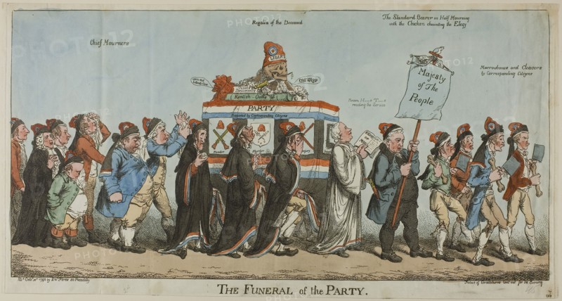

{fig-align="center"}

*Ritratto di una cultura attraverso un suo esponente.*

Pur sempre elegante nella sterminata galleria di sciattoni dell’Italietta nostrana, con la sua morte ha reso ancora più evidente la funzione che incarnava. La sua immagine pubblica è stata la maschera attraverso cui il conformismo culturale ha ottenuto riconoscimento e prestigio accreditandosi come voce indipendente. Questa funzione viene oggi riconosciuta, sia pure con segno opposto, tanto da chi vorrebbe raccoglierne l’eredità quanto da chi apertamente lo avversa: cambiano i giudizi, non la centralità del ruolo. Lo ribadisce, solennemente, anche il suo congedo, in cui ricorda che la vita non è un bip, senza però accorgersi che l’eutanasia da lui predicata è medicalizzazione quanto l’accanimento terapeutico: l’etichetta cambia, la logica è la stessa.

La persona, nel bilancio di ciò che resta, conta meno del personaggio: di lui resta più il liceale saccente vestito a festa che il professore che dispensa compassate verità. Della tolleranza faceva una posa; della longevità sulla scena, un titolo di merito e un motivo di fascino. Nella sua visione, le rovine del classicismo si equivalevano a quelle del dopoguerra, in un antifascismo di maniera, buono per ogni stagione. Esponente compiaciuto di una cultura di sistema, zelante interprete delle convenzioni del progressismo liberale, sostenitore del sionismo, del riarmo europeo e dell’uso della forza armata in funzione difensiva, devoto all’ateismo fino a rendersene messia, ha contribuito a confondere l’autorevolezza con la compostezza e il pensiero critico con l’idolatria di una scienza trasformata in dogma. Tutto questo, con un garbo ormai insolito, sviluppato senza riserve. Ma quale la gloria?

Le sue parole, vane; i suoi libri, inutili. Tra libri e libracci passa una differenza: i primi aprono un campo, i secondi certificano appartenenze. Ne ho ancora qualcuno a bottega. Forse adesso qualcuno li comprerà: non per leggerli, ma per ostentarli. Questo, per loro, è il momento migliore. A me però le appartenenze non appassionano: non mi interessa arruolare né i suoi fan né i suoi detrattori, ma capire il senso della sua esperienza. Personalmente, Corrado Augias non mi era antipatico. Non sento l’obbligo di applaudire il circo di cui faceva parte. Se è vero che ha posto la propria firma sul diritto al fine vita, lo ha fatto pur sempre con una certa eleganza. E laddove è rimasto prigioniero della produttività anche dopo morto, è del tutto coerente che il suo paradiso resti lo schermo. 

*Immagine: Charles WIlliams, The Funeral of the Party, published by S. W. Fores 30 October 1798, England (hand-colored etching on ivory laid paper)*
